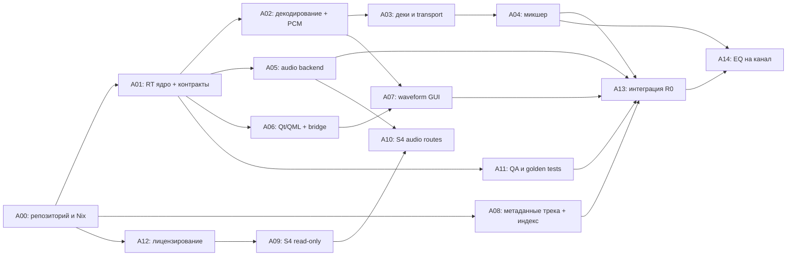
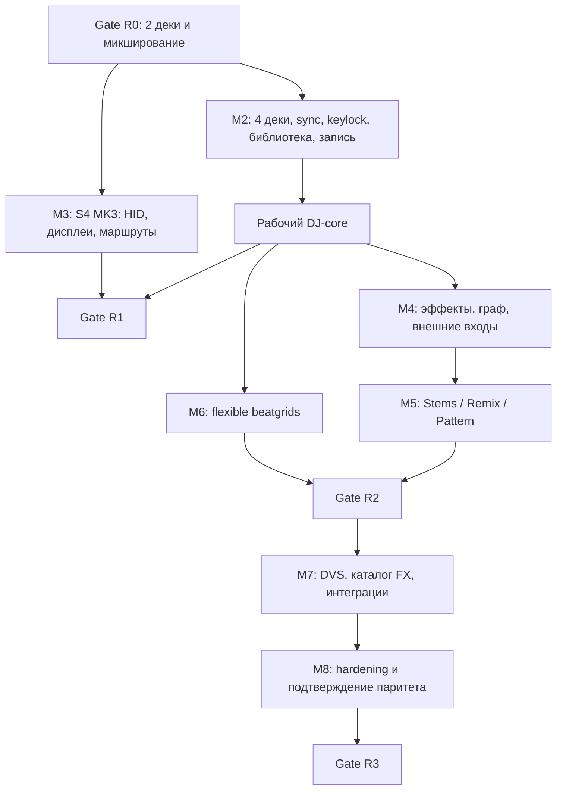

# DJ Platform — план реализации

**Документ:** DJP-PLAN-001  
**Версия:** 0.1  
**Дата:** 2026-11-04  
**Статус:** план к исполнению после утверждения архитектурных решений  
**Основа:** `DJ_Platform_TZ_v0.1_RU.md` (DJP-SRS-001), `DJ_Platform_Initial_Backlog_v0.1.yaml`  
**Цель:** независимая реализация DJ-платформы с максимальным практическим функциональным паритетом Traktor Pro 4; первая целевая ОС — Linux/NixOS; первый обязательный аппаратный профиль — Traktor Kontrol S4 MK3.

> Этот документ задаёт **порядок реализации, зависимости, деление работы между ИИ-агентами, проверку результатов и условия релизов**. Полный состав функций, ограничения и точные формулировки требований находятся в ТЗ. При противоречии приоритет имеет ТЗ; расхождение оформляется как issue и ADR, а не разрешается молчаливым изменением кода.

---

## 1. Стратегия исполнения

### 1.1. Основные принципы

1. **Собственный продукт, а не fork:** движок, доменная модель, код GUI и система управления проектируются независимо. Допустимы общие библиотечные компоненты после проверки лицензий; код и ресурсы Traktor/Mixxx не переносятся.
2. **Вертикальные срезы вместо долгой разработки отдельных слоёв:** как можно раньше получить работающую цепочку «файл → две деки → микшер → аудиовыход → UI», затем наращивать возможности.
3. **Headless-first:** каждую аудиофункцию сначала можно проверить без Qt и физического устройства посредством воспроизводимого offline render.
4. **RT-контракт важнее удобства реализации:** audio callback не аллоцирует, не ждёт блокировок, не выполняет дисковых/сетевых операций, не обращается к UI и не вызывает ML. Все тяжёлые операции — вне RT.
5. **Contract-first для параллельных ИИ-агентов:** сначала типы, события, схемы и тестовые ожидания; потом независимая реализация модулей.
6. **Evidence-based готовность:** демонстрация, отчёт тестов и измерения обязательны. Сгенерированный код сам по себе не является выполнением задачи.
7. **Поэтапная аппаратная безопасность:** S4 MK3 — сначала только чтение HID, затем разрешённая подсветка/дисплеи, потом контролируемые моторизованные джоги. Никаких прошивок и неизвестных пакетов.
8. **Функциональный, а не буквальный паритет:** проверяем сценарии, поведение и доступность функций; используем собственные значки, темы, аудиоматериалы и собственную реализацию эффектов.

### 1.2. Рабочие определения

- **M0–M8** — инженерные этапы из ТЗ; часть работ может выполняться параллельно.
- **R0–R3** — проверяемые релизные рубежи: R0 — базовая вертикаль; R1 — полноценный рабочий DJ-core; R2 — расширенные модули; R3 — максимальный целевой паритет.
- **Gate** — обязательная проверка, без которой этап/релиз нельзя считать закрытым.
- **Spike/PoC** — ограниченное исследование с решением и протоколом измерений; само по себе не является production-ready функцией.
- **ADR** — Architecture Decision Record, документированное архитектурное решение.
- **Owner** — один ответственный за интеграцию модуля; ИИ-агенты могут помогать, но не принимают критические изменения самостоятельно.

### 1.3. Иерархия документов

| Документ | Роль |
|---|---|
| `DJ_Platform_TZ_v0.1_RU.md` | Источник требований `DJP-*`, нормативов и приёмочных критериев |
| `DJ_Platform_Implementation_Plan_v0.1_RU.md` | Последовательность разработки и контроль исполнения |
| `DJ_Platform_Initial_Backlog_v0.1.yaml` | Стартовые задачи A00–A13, которые разворачиваются в issues |
| `docs/requirements/traceability.csv` | Связь «требование → реализация → тест → свидетельство» |
| `docs/parity/matrix.csv` | Независимая проверка паритета с зафиксированной версией Traktor Pro 4 |
| `docs/adr/*.md` | Решения по лицензии, аудиобэкенду, UI bridge, форматам, протоколам |
| `docs/qa/*.md` и `benchmarks/` | Методики, результаты и ограничения измерений |
| `docs/agents/AGENTS.md` | Правила исполнения задач ИИ-агентами |

---

## 2. Очерёдность и критический путь

### 2.1. Главная цепочка зависимостей



**Критический путь к R0:** `A00 → A01 → A02 → A03 → A04 → A13`, плюс обязательные ветки `A05`, `A06/A07`, `A08` и `A11`. `A12` — административный/лицензионный gate для включения зависимостей. `A09/A10` полезно начать рано, но аппаратная проверка S4 **не блокирует R0 desktop-demo**; она блокирует соответствующую готовность R1. `A14` вынесена из R1 по решению владельца: базовый трёхполосный EQ нужен раньше моделей фильтра, но после того, как R0 собран, поэтому она не входит в критический путь к R0.

### 2.2. Зависимости следующих релизов



Важное уточнение: advanced-sync и Stem/Remix не нужно жёстко сериализовать. Они могут идти параллельно после стабилизации общего beat timeline, audio graph API и схемы сессий.

---

## 3. Этапы разработки и измеримые результаты

Оценки — **человеко-недели инженерной работы**, перенесённые из ТЗ. Они не являются обещанием календарных сроков; ИИ ускоряет создание кода и тестов, но не отменяет интеграцию, прослушивание, профильную экспертизу и аппаратную проверку.

| Этап | Релиз | Результат | Предварительный объём | Gate |
|---|---|---|---:|---|
| **M0 — Blueprint** | Подготовка | Среда, лицензии, RT proof, API v1, тестовый стенд | 2–4 чел.-нед. | G0 |
| **M1 — Audio vertical slice** | **R0** | 2 деки, Cue/Loop, waveforms, mixer, реальный звук и headless render | 6–12 чел.-нед. | G1/R0 |
| **M2 — Performing core** | **R1** | 4 деки, BPM/Sync, keylock, cue-routing, библиотека, recording | 10–18 чел.-нед. | G2 |
| **M3 — Hardware / UX** | **R1** | S4 MK3, профили, аппаратные аудиомаршруты, экраны при подтверждённом PoC | 8–16 чел.-нед. | G3/R1 |
| **M4 — FX / advanced mixing** | **R2** | FX graph, FX units, расширенная маршрутизация, loop recorder | 8–14 чел.-нед. | G4 |
| **M5 — Stems / Remix / Pattern** | **R2** | 4 stems, ML worker, Remix Deck, Pattern Player | 14–28 чел.-нед. | G5 |
| **M6 — Advanced sync** | **R2** | Flexible Beatgrids, tempo maps, внешние часы | 8–16 чел.-нед. | G6/R2 |
| **M7 — Parity / integrations** | **R3** | Функциональные аналоги полного каталога FX, DVS, допустимые интеграции | 16–32 чел.-нед. | G7 |
| **M8 — Product hardening** | **R3** | Стресс-тесты, аудит качества, UX, дистрибутивы, документация | 12–24 чел.-нед. | G8/R3 |

**Правило планирования:** оценка по каждой задаче уточняется после spike или завершения предыдущего этапа. Суммировать диапазоны как точный срок нельзя: этапы пересекаются, часть PoC может закончиться отрицательным результатом, а R3 зависит от доступности сторонних сервисов и форматов.

### M0 — Подготовка (G0)

**Задачи:** `A00`, `A12`, начало `A01`, `A05` (исследование), `A09` (read-only), `A11` (тестовая стратегия).

**Выполнить:**

1. Создать Cargo workspace, Qt/CMake shell, воспроизводимый `flake.nix`, CI, команды `dev/test/bench`.
2. Утвердить `ADR-001` (лицензия) и завести `THIRD_PARTY.md` до выбора компонентов с ограничениями.
3. Описать словарь событий/команд, audio-frame timebase и DTO; ввести схемы `command-v1`, `state-v1`.
4. Зафиксировать RT contract и обеспечить детерминированный headless runner для простого генератора сигнала.
5. Измерить реальные устройства (в том числе аудио S4 MK3) и выбрать основной backend через `ADR-002`.
6. Зафиксировать `ADR-003`: внутрипроцессный UI bridge либо IPC; в любом случае RT-критическая часть независима от UI.
7. Подготовить эталонные аудиофайлы, контрольное окружение, шаблон test evidence и первые записи traceability.
8. Создать `docs/parity/reference-inventory.md`: версия эталонного Traktor, источники, перечень сценариев, список функций, которые запрещено копировать буквально.

**Выход G0:** чистая сборка на NixOS, проходят базовые тесты, 440 Гц рендерится с точным числом кадров, лицензии критических зависимостей оценены, протоколы и владелец каждого базового crate зафиксированы. Решение по hardware MIDI/HID может оставаться `unknown`, но без притворной отметки «поддерживается».

### M1 — Первый работающий аудиопродукт (R0)

**Задачи:** `A01`–`A08`, `A11`, `A13`; `A09/A10` выполняются независимо при наличии оборудования.
`A14` (трёхполосный EQ на канал) идёт сразу за G1 — вынесена из R1 решением владельца.

**Выполнить:**

1. `dj-codec`: WAV/FLAC и после проверки зависимостей MP3/Ogg; seek и bounded PCM prefetch; недоступность файла и ошибки декодера обрабатываются корректно.
2. `dj-deck`: две независимые деки A/B; play/pause/cue/seek, 8 hotcues, лупы, операции на границах файлов.
3. `dj-mixer`: channel gain, crossfader, master, cue-архитектура, meters; отсутствие неверной утечки в другие шины.
4. `dj-audio-io`: вывод через выбранный backend, device selection, диагностика xruns/underruns, безопасное отключение.
5. `dj-analysis`: waveform cache; временная ось точно соответствует source frames.
6. `dj-library`/`dj-session`: переносимые метаданные трека (`.djmeta` рядом с музыкой, зеркало для
   read-only носителей), индекс SQLite только для поиска и сортировки, миграция и backup.
7. `dj-ui`: двухдековая QML-сцена и браузер файлов; Play/Cue отражают подтверждённое состояние движка, а не локальную UI-модель.
8. `dj-headless`: сценарий воспроизведения и сведения двух файлов, сохраняющий WAV с воспроизводимым результатом.
9. Интеграция, диагностика и документированный demo-сценарий.

**Выход G1/R0:** два файла одновременно воспроизводятся на физическом аудиоустройстве; доступны Cue/Loop, waveform и crossfader; cue сохраняются; GUI не блокирует звук; headless fixture воспроизводим; RT-аудит пройден. Запись и четыре деки не блокируют R0.

### M2 — Полноценный performing core (подготовка R1)

**Задачи нового пакета:** `B01`–`B10` (см. §5).

**Выполнить:**

1. Расширить scheduler, mixer и UI до четырёх параллельных дек без изменения базового командного протокола или с контролируемой v2-миграцией.
2. Реализовать BPM analysis, ручные статические beatgrids, master clock, Beat Sync, Tempo Sync, Quantize и Snap.
3. Реализовать time-stretch/keylock с измерением артефактов, задержки и потребления CPU; не выдавать обычный ресэмплинг за keylock.
4. Реализовать Beatjump, Slip/Flux, Reverse, pitch ranges, управляемые нюансы Cue/Loop.
5. Добавить модели EQ/filter (четырёхполосный, параметрический) поверх базового трёхполосного `A14`, cue/PFL,
   master/headphones/booth, limiter, four-channel routing.
6. Реализовать recorder через RT→ring→worker с проверяемым финальным WAV.
7. Реализовать поиск, плейлисты, smart playlists, пакетный импорт и analysis-lock для библиотеки.
8. Реализовать восстановление сессии, настройки устройств, раскладок и безопасные миграции.

**Выход G2:** 4-deck demo работает с headless reference и GUI; BPM/Sync выдерживает контрольные сценарии; запись не блокирует звук; библиотека и проект переживают перезапуск/миграцию; cue routing проверен отдельными сигналами. Это ещё не R1 до аппаратного и длительного тестирования.

### M3 — S4 MK3 и готовность к выступлению (R1)

**Задачи:** `A09`, `A10`, `B11`–`B15`.

**Выполнить:**

1. Создать универсальный слой MIDI/HID, capability negotiation, профили устройств и безопасные назначения.
2. Зафиксировать реальный протокол ввода S4 MK3: кнопки, крутилки, фейдеры, джоги, пэды, браузер; хранить только законно полученные сведения и собственный код.
3. Связать transport, mixer, cues, loops и browser с S4; реализовать LED feedback только для проверенных outbound-пакетов.
4. Проверить раздельные реальные аудиовыходы master/cue/booth. Не смешивать успех HID с подтверждением работоспособности аудио I/O.
5. Проверить hotplug, reconnect, lost device, потерю питания USB и восстановление состояния.
6. Провести ограниченный PoC двух дисплеев (вход/выход без неизвестных USB-команд) и решить, включать ли их в R1.
7. Оставить моторизованные джоги выключенными до отдельного safety gate с ограничениями момента/скорости/аварийным отключением.
8. Провести минимум двухчасовой live soak на зафиксированном стенде.

**Выход G3/R1:** основные функции для живого DJ-сета выполняются на четырёх деках, с аппаратного S4 MK3; отдельные master/headphones/booth проверены на существующих физических разъёмах там, где они доступны; длительный тест подтверждён отчётом; неподтверждённые экраны/моторы честно помечены как `partial` или `blocked` и не считаются выполненными требованиями полного R1, если для выбранной матрицы R1 они обязательны.

### M4 — Расширенный FX/маршрутизация (подготовка R2)

**Задачи:** `C01`–`C06`.

**Выполнить:**

1. Заморозить API DSP-узла: `prepare/process/reset/latency_frames/tail_frames`, параметры, smoothing, bypass, preset.
2. Реализовать четыре FX Units, режимы Single/Group, insert/send/post-fader, snapshot routing и автоматизацию.
3. Реализовать стартовый каталог эффектов (filter, delay, echo, reverb, flanger, phaser, beat repeat, gater, distortion, EQ) с независимыми offline fixtures.
4. Добавить BPM-synced FX, Loop Recorder, overdub/undo, external inputs/live input и стабильные многоканальные маршруты.
5. Измерить обработку 4 дек + цепочки эффектов; запрещён неограниченный рост tail buffers/CPU.

**Выход G4:** конфигурации FX применяются в реальном времени без незапланированных щелчков или разрыва главного микса; все цепочки имеют измеренную стоимость и тесты, включая обход неисправного эффекта.

### M5 — Stems, Remix и Pattern (подготовка R2)

**Задачи:** `C07`–`C15`.

**Выполнить:**

1. Ввести общую timeline для четырёх Stem-слоёв Drums/Bass/Vocals/Other, их независимых gain/mute/filter/FX send и waveform lanes.
2. Подготовить формат и версионирование stem-asset cache (source fingerprint, model version, latency alignment).
3. Вынести ML inference в отдельный процесс с очередями, отменой, лимитами RAM/VRAM и CPU fallback.
4. Реализовать проверку sum-of-stems/тайминга и целостности при сбое или отмене.
5. Реализовать Remix Deck (4 слота, sample cells, one-shot/loop, quantized trigger, set persistence).
6. Реализовать Pattern Player как sequencer с привязкой к master clock, собственным сэмплами/паттернами и FX routing.
7. Проверить активность ML на GPU при живом миксе: сбой/перегрузка inference не должен ломать воспроизведение уже подготовленных PCM.

**Выход G5:** stem-дек работает со строго согласованными слоями, Remix/Pattern запускаются по музыкальной сетке, пресеты сохраняются, ML не нарушает RT; оригинальные наборы семплов включены только при наличии прав.

### M6 — Продвинутая синхронизация (R2)

**Задачи:** `C16`–`C19`.

**Выполнить:**

1. Утвердить формальную модель `beat_position = f(source_time)` для гибких beatgrids с непрерывной монотонной tempo map.
2. Реализовать редактирование маркеров и скачков темпа на протяжении трека, без потери точности source frame.
3. Проверить Sync/Loop/Beatjump, переходящие через границы tempo-map segments, включая ускорение/замедление живой записи.
4. Реализовать MIDI Clock send/receive как ещё один `TempoSource`; Ableton Link — только после лицензионного gate и как отдельный адаптер (задача `D15`, R3).
5. Свести master beat timeline всех deck modes (Track/Stem/Remix/Pattern).

**Выход G6/R2:** комплексные сценарии с variable tempo, stems, pattern и FX синхронизированы и проходят property tests; рабочие сценарии R2 закрыты в матрице без подмены `done` на `partial`.

### M7 — Паритет по каталогу и внешние интеграции (подготовка R3)

**Задачи:** `D01`–`D07`.

**Выполнить:**

1. Закрыть покрытие классов 43 FX и 9 Mixer FX функциональными аналогами, с описанием отличий звука и управления.
2. Реализовать собственный максимайзер, расширенное управление записью, продвинутый Loop Recorder и системные профили.
3. Реализовать DVS на законно доступных timecode/носителях с калибровкой и dropout behaviour.
4. Добавить опциональные controller/CDJ adapters и online integrations **только** при разрешённых API/лицензиях; Ableton Link — `D15`, только при коммерческой лицензии.
5. При законной и технической возможности добавить односторонний импорт пользовательских данных, не обходя DRM и не копируя закрытые форматы наугад.
6. Закрыть `docs/parity/matrix.csv` по выбранной эталонной версии, включая обоснованные `blocked-external` и `excluded-legal`.

**Выход G7:** все требования R3 имеют либо реализацию с доказательствами, либо явно согласованное исключение/ограничение; число реализованных функций не подменяется маркетинговой формулировкой «полный клон».

### M8 — Подготовка продукта к стабильному использованию (R3)

**Задачи:** `D08`–`D14`.

**Выполнить:**

1. Провести soak/fault-injection при 4 деках, FX, записи, аппаратном вводе, фоновой индексации и ML.
2. Протестировать аудиоподсистему на нескольких backend/device/sample-rate combinations; измерить round-trip latency петлёй.
3. Провести аудит безопасности парсеров, HID, загрузки моделей, local file operations и зависимостей; настроить SBOM.
4. Провести usability-прогоны по приоритетным сценариям Traktor без копирования фирменных изображений.
5. Проверить восстановление сессий, резервное копирование, миграции, downgrade/recovery-policy.
6. Подготовить установочные пакеты для Linux; Windows/macOS — отдельные платформенные планы после подтверждения архитектуры.
7. Выпустить release notes, руководство, диаграмму маршрутов, список совместимых контроллеров и честно обозначенные ограничения.

**Выход G8/R3:** стабильный релиз с подтверждённым набором сценариев, опубликованной матрицей ограничений и измерений; ни один критический отказ звука или потеря пользовательских данных не остаётся без зафиксированного решения.

---

## 4. Формальные release gates

### Gate G0 — архитектура и среда

- [ ] `nix develop`, `cargo fmt --check`, `cargo clippy --workspace -- -D warnings`, `cargo test --workspace` успешно проходят в чистой среде.
- [ ] Запускается пустой Qt/QML shell; команда сборки документирована.
- [ ] Одноканальный/стерео синус 440 Гц рендерится в headless с заданным числом кадров.
- [ ] Утверждены ADR-001 (license), ADR-002 (backend), ADR-003 (UI bridge) либо оформлены ограничивающие эксперименты со сроком решения.
- [ ] Приняты command/state schema v1, timebase и RT contract.
- [ ] Включена трассировка требований, отдельный список сторонних лицензий и контрольные audio fixtures.

### Gate G1 / R0 — playable vertical slice

- [ ] Две одновременно играющие деки A/B с реальным выбором разных файлов.
- [ ] Play/Pause/Cue, 8 hotcues, loops, volume, crossfader, waveform и управление GUI работают сквозным образом.
- [ ] Сохранение и восстановление cue/track state подтверждены тестом.
- [ ] Файл вывода headless render детерминирован и совпадает с golden baseline в заданных допусках.
- [ ] На физическом аудиоустройстве нет нарушений RT contract при тестовой конфигурации; отчёт указывает устройство, backend, частоту и буфер.
- [ ] Негативные тесты для отсутствующих/битых файлов, EOF, underrun и отказа UI проходят.

### Gate G2–G3 / R1 — live-capable

- [ ] Четыре деки могут воспроизводиться и микшироваться одновременно.
- [ ] Стабильно работают BPM/Sync/Beatgrid, Keylock, PFL, recording, библиотека, layout и session restore.
- [ ] Кнопки/фейдеры/крутилки S4 MK3 управляют ключевыми функциями; известные outbound LED-команды проверены.
- [ ] Маршруты master/headphones/booth подтверждены на реальном устройстве в пределах доступных портов.
- [ ] Зафиксирован hardware soak ≥2 ч с **0 application xruns** на квалифицированном стенде и указанными внешними xruns, если были.
- [ ] При 48 кГц / 256 frames p99 времени обработки блока **<60% периода**, максимум **<85%** на согласованной четырёхдековой нагрузке (цели ТЗ, не обещания для всех ПК).
- [ ] Отдельная проверка физической round-trip latency; целевой профиль **<20 мс**, при недостижении публикуется реальный результат и причина.

### Gate G4–G6 / R2 — advanced features

- [ ] Четыре логических FX Units, режимы Single/Group и тестированный начальный набор FX.
- [ ] Stem Deck, фоновое разделение, Remix и Pattern имеют собственные форматы и восстановление состояния.
- [ ] Flexible Beatgrid работает на материалах с переменным BPM; переходы сегментов покрыты тестами.
- [ ] При отказе ML процесса текущий звук и пользовательская коллекция не повреждаются.
- [ ] Внешние MIDI clocks обрабатываются с предсказуемым fallback.
- [ ] Для всех функций R2 обновлены тесты, документация, матрица паритета и сопоставление с требованиями.

### Gate G7–G8 / R3 — parity & stable release

- [ ] Для 43 FX и 9 Mixer FX зафиксированы аналоги, демонстрационные сценарии и известные отличия.
- [ ] DVS и внешние интеграции имеют документированные юридические и технические ограничения.
- [ ] Проводились fuzz, stress, soak, unplug, device loss, recording crash и восстановление из резервной копии.
- [ ] Пакеты, лицензии, SBOM, пользовательская документация и release notes подготовлены.
- [ ] Все обязательные `DJP-*` закрыты как `verified`, либо формально исключены с отдельным решением владельца продукта. Статус `blocked` не эквивалентен `verified`.

---

## 5. Backlog: последовательность выполнения

### 5.1. Начальный backlog A00–A13 — без переименования

| ID | Работа | Старт / зависимости | Выход |
|---|---|---|---|
| **A00** | Репозиторий, `flake.nix`, Rust/Qt/CI | Сразу | Воспроизводимый build и test |
| **A12** | Лицензия, зависимости, ADR-001 | Сразу | Approved license policy/`THIRD_PARTY.md` |
| **A01** | RT queue, command/state protocol, deterministic runner | После A00 | Headless 440 Гц, RT contract |
| **A08** | Портативные метаданные трека (`.djmeta`) и индекс SQLite над ними | После A00, A02 | Пять проверок переносимости + тест восстановления индекса |
| **A09** | Безопасное read-only исследование S4 MK3 | После A00/A12 | Протокол входных событий, `hardware-not-verified` до теста |
| **A11** | Testkit, golden WAV, CI, traceability | После A00/A01 | QA gate |
| **A05** | Linux audio backend и bench | После A01 | ADR-002, loopback report |
| **A06** | Qt/QML shell, bridge | После A00/A01 | Play/Cue по engine snapshot |
| **A02** | Decoder + PCM prefetch | После A00/A01 | Stream/seek/EOF/underrun tests |
| **A07** | Waveform generation/render/cache | После A02/A06 | Frame-accurate waveform |
| **A03** | Две деки, transport, Cue/Loop | После A01/A02 | Headless two-deck |
| **A04** | Mixer, bus, crossfader | После A01/A03 | Routing fixtures |
| **A10** | Реальные audio routes S4 MK3 | После A05/A09 | Подтверждённая таблица Main/Cue/Booth |
| **A13** | Интеграционный demo R0 | После A01–A08/A11 (по YAML, без A09/A10) | Gate R0 evidence |
| **A14** | Трёхполосный EQ на канал: low, mid, high | После A04, A05, A08, A13 (по решению владельца — сразу за R0) | Измеренная АЧХ, три ручки в полосе канала |

**Важно:** детали, acceptance и роли A00–A14 берутся из `DJ_Platform_Initial_Backlog_v0.1.yaml`, а не из сокращённой таблицы выше. A10 формально относится к R1, хотя исследуется раньше. Ссылка A13 на A01–A08 означает весь базовый набор, а не необходимость завершить A09/A10.

### 5.1.1. Метаданные трека: раскладка

Cue-точки, сетки и прочие пользовательские данные не живут в базе. Они едут вместе с музыкой:

```text
/Music/Album/Song.flac                    — аудио
/Music/Album/.djmeta/Song.flac.json       — его метаданные (схема djp-track-v1)
~/.local/share/hauler-dj/meta/<volume-id>/<путь внутри носителя>.json   — зеркало
```

- `.djmeta` создаётся при первом изменении метаданных трека, а не при сканировании: чужие папки не
  должны обрастать служебными каталогами от одного просмотра.
- Зеркало пишется всегда и служит домом для носителей только для чтения; расхождение копий решается
  по `revision` и `updated_at`, проигравшая версия уходит в `conflicts/`, а не затирается.
- SQLite хранит только то, по чему ищут и сортируют, и пересобирается сканированием: удаление базы не
  теряет ни одной cue-точки.
- Волновая форма и пики в метаданные не входят: производное по `DJP-DATA-003`.
- Запись в теги самого файла (ID3 GEOB, Vorbis `DJP_META`, MP4 freeform) — отдельная команда, не
  поведение по умолчанию.

### 5.2. Новые задачи для R1 (предложение к заведению после утверждения)

| ID | Результат | Зависимости | Требования |
|---|---|---|---|
| **B01** | 4-deck scaling / scheduler / mixer buses | A03, A04 | DJP-DECK-009, DJP-MIX-002 |
| **B02** | BPM detection и static beatgrid editor | A02, A07, A08 | DJP-MEDIA-006, DJP-SYNC-003 |
| **B03** | Master clock, Tempo Sync, Beat Sync, Quantize | B01, B02 | DJP-SYNC-001/002, DJP-DECK-005 |
| **B04** | Time-stretch / Keylock с latency accounting | A03, A11 | DJP-DECK-008, DJP-ARCH-008 |
| **B05** | Transport extras: Beatjump, Slip/Flux, Reverse | A03, B02 | DJP-DECK-006/007 |
| **B06** | Модели EQ/filter (4-полосный, параметрический), PFL, limiter, output routing — базовый 3-полосный уже в `A14` | A04, A05, B01, A14 | DJP-MIX-002/003/004/006 |
| **B07** | Recording worker и тесты файлов | A01, B06 | DJP-MIX-005 |
| **B08** | Library FTS, playlists, mass import, analysis jobs | A08, B02 | DJP-MEDIA-004–008 |
| **B09** | Session/settings backup and recovery | A08, A06 | DJP-SET-001–003 |
| **B10** | 4-deck UI layouts, workflow, app instrumentation | A06, A07, B01 | DJP-UI-003–005 |
| **B11** | Generic MIDI learn и controller mapping engine | A09, A01 | DJP-CTRL-001/002 |
| **B12** | S4 transport/mixer/loop mapping | A09, B11, B01 | DJP-CTRL-003 |
| **B13** | S4 audio route, hotplug/reconnect, udev | A10, B12 | DJP-CTRL-003/004 |
| **B14** | S4 LED + display PoC с safety gate | A09, B12 | DJP-CTRL-005/007 (scope уточнить) |
| **B15** | R1 live soak, recovery, latency и issue triage | B03, B04, B06–B13 | DJP-NFR-002–008 |

**Замечания к B02, B03, B05** (разбор `tmp/ableton-link.md`, 2026-11-08):

- **B02, анализ — в фоне, не в аудиопотоке.** Детекция идёт тем же путём, что loudness (`dj-analysis`,
  worker), результат ложится в `.djmeta` (поле beatgrid уже описано в `A08`: якорь, BPM, `revision`),
  аудиопоток только читает готовый грид. Анализ обязан быть повторяемым: один и тот же файл — тот же BPM,
  иначе переанализ будет спорить с ручными правками владельца.
- **B02, лицензионная ловушка.** Рекомендованные в документе Aubio, Essentia и Super4PCS нам не подходят:
  Aubio — GPL-3.0+, Essentia — AGPL-3.0+, Super4PCS — регистрация облаков точек, к музыке отношения не имеет;
  по ADR-0001 такой код включать нельзя. Детекция — своя: спектральный поток (onset) на `signalsmith-fft`
  плюс автокорреляция либо гребёнка по интервалам 60…200 BPM; half/double и tap tempo остаются ручными
  обходами (DJP-SYNC-003).
- **B03, источник времени один и он за интерфейсом.** Внутренний clock, MIDI Clock (`C18`) и Ableton Link
  (`D15`) — три реализации одного `TempoSource` (`tempo`, `beat_at(host_time)`, `is_playing`). Деки не
  должны знать, кто сейчас ведёт: иначе каждая новая интеграция переписывает sync.
- **B03, фазу правит только темп, без seek.** Подгонка — временное изменение скорости через существующий
  keylock/ресемплер; прыжок позиции даёт щелчок и слышимый разрыв. Обязательны сглаживание и ограничение
  скорости изменения темпа (порядка 0,5 %/с), иначе слышно «дыхание». Отдельный механизм не нужен: питч
  ±16 % уже меняет отношение вход/выход ресемплера, подгонка — микрошаг к текущему темпу.
- **B03, ошибка фазы — по кратчайшему пути в пределах половины такта.** `err = wrap(target − deck + half) − half`
  в битах; без этого на границе такта синхронизация дёргается через весь такт.
- **B03, задержку тракта компенсировать обязательно.** Синхронизируется то, что слышно:
  `keylock 2880 кадров + master limiter 240` (обе величины движок уже публикует в снапшоте, брать оттуда,
  а не из констант). Без этого фаза «на слух» уезжает на 60 мс — больше шестнадцатой при 128 BPM.
- **B03, Instant Sync на старте — две стратегии, обе без разрыва.** Либо старт с ближайшей квантованной
  доли (цена — до одного бита ожидания), либо старт сразу с догоном, если фаза почти совпала; сильно
  отставшую деку догонять скоростью нельзя («взвизг»), надо начинать со следующей доли. Пороги — после
  замера на лупах, не из статьи.
- **B05, beatjump и quantize — по гриду из `B02`.** Шаг в долях бита/такта (1/4, 1/2, 1, 2, 4, 8), цель —
  ближайшая граница сетки; при выключенном quantize — ровный шаг по времени. Лупы живут в кадрах, поэтому
  quantize применяется при постановке, а не при воспроизведении.

### 5.3. Новые задачи для R2

| ID | Результат | Зависимости | Требования |
|---|---|---|---|
| **C01** | DSP node contract, parameter smoothing, graph swaps | B06, A01 | DJP-ARCH-008–010 |
| **C02** | 4 FX Units, Single/Group, routing/presets | C01, B09 | DJP-FX-001–003 |
| **C03** | Стартовые 10 FX с golden tests | C01, C02 | DJP-FX-004 |
| **C04** | BPM FX, tails, underrun/failure behaviour | C03, B03 | DJP-FX-007/008 |
| **C05** | Loop Recorder, overdub, undo, Remix export | B07, B03 | DJP-MIX-007 |
| **C06** | External mixer/live inputs/multichannel routing | B06, A10 | DJP-MIX-008 |
| **C07** | Stem playback model: 4 layers, shared clock | B01, B03, B04 | DJP-STEM-001–003 |
| **C08** | Stem cache / versions / asset alignment | C07, B08 | DJP-STEM-005 |
| **C09** | Isolated stem-worker with CPU/GPU fallback | C08 | DJP-STEM-004/006 |
| **C10** | Stem waveform/editor/UI and controller mappings | C07, C08, B10 | DJP-STEM-002/003 |
| **C11** | ML safety/quality/latency validation | C09, C10 | DJP-STEM-004–006 |
| **C12** | Remix Deck: 4 slots, sample cells | B01, B03 | DJP-REMIX-001/002 |
| **C13** | Remix Sets open persistence, UX | C12, B09 | DJP-REMIX-003 |
| **C14** | Pattern Player engine/step sequencer | B03, C02 | DJP-REMIX-004 |
| **C15** | Pattern sync/UI/preset integration | C13, C14, B10 | DJP-REMIX-004 |
| **C16** | Mathematical tempo-map data model | B02, B03 | DJP-SYNC-004 |
| **C17** | Flexible beatgrid editor, looping across segments | C16, B05 | DJP-SYNC-005 |
| **C18** | MIDI Clock I/O, external clock fallback | B03, B11 | DJP-SYNC-006 |
| **C19** | R2 cross-deck sync, Stem/Remix/Pattern test matrix | C07, C12, C14, C17 | DJP-SYNC-008 |

**Замечания к C16–C18** (там же):

- **C16, модель — якорь плюс сегменты.** Прямой грид: один якорь `(beat, source_frame)` и BPM,
  `beat = anchor_beat + (t − anchor_time)·bpm/60`, O(1) в аудиопотоке. Гибкий: сегменты с постоянным
  темпом плюс кэш текущего сегмента; поиск сегмента — на границе, не в каждом сэмпле.
- **C16, снимок без блокировок.** Аудиопоток читает неизменяемый снимок (двойной буфер, подмена на границе
  блока), правка в UI готовит новый снимок в фоне. Иначе правка сетки на живой деке даёт щелчок — тот же
  класс ошибки, что был с ручкой EQ в `A14`.
- **C17, редактор — сдвиг и растяжение.** Сдвиг двигает все линии без изменения BPM, растяжение меняет BPM
  маркера или сегмента; обе операции — на монотонной функции с проверкой, что порядок маркеров не нарушен.
- **C17, линии сетки кэшируются.** Считаются на перерисовку видимого окна волны, а не на каждый кадр:
  иначе 4 деки × десятки тысяч биений дают просадку UI.

### 5.4. Новые задачи для R3

| ID | Результат | Зависимости | Требования |
|---|---|---|---|
| **D01** | Каталог 43 FX-классов/аналогов и per-FX tests | C03, C04 | DJP-FX-005 |
| **D02** | 9 Mixer FX-классов/аналогов | D01, B06 | DJP-FX-006 |
| **D03** | Максимайзер, expanded recording и broadcasting | B07, C01 | DJP-MIX-010–012 |
| **D04** | DVS parser/transport/calibration on lawful formats | B03, B11, C17 | DJP-CTRL-009 |
| **D05** | Контроллеры/CDJ и дополнительные профили | B11, B13 | DJP-CTRL-008/010 |
| **D06** | External integrations/adapters gated by agreements | B08, B09 | DJP-MEDIA-010/011, DJP-SYNC-007 |
| **D07** | Полная parity-matrix, decision log, deviation review | D01–D06, C19 | DJP-UI-008, DJP-GOAL-002 |
| **D08** | 4-deck 2h+ soak и jitter/CPU/memory benchmark | D07 | DJP-NFR-001–008 |
| **D09** | Fault injection: audio/USB/disk/ML/UI failure | D08 | DJP-NFR-007/011/015/016 |
| **D10** | Security/dependency/legal review и SBOM | D06 | DJP-NFR-012/013, DJP-LIC-* |
| **D11** | UX usability tests и visual familiarity review | D07 | DJP-UI-008 |
| **D12** | Session recovery/backup/versioning test suite | B09, D09 | DJP-SET-002/003 |
| **D13** | Release packaging, guides и install tests | D08–D12 | DJP-ENV-001/003/004 |
| **D14** | R3 release candidate, signed-off acceptance | D13 | Все согласованные DJP-* |
| **D15** | Ableton Link: отдельный адаптер `TempoSource` (чтение и публикация темпа общей сессии), за feature-флагом и лицензионным gate | B03, C18, D06 | DJP-SYNC-007 |

**Замечания к D15** (Ableton Link):

- **Сначала лицензия, потом код.** Link распространяется под GPLv2+ или коммерческой лицензией; ADR-0001
  прямо запрещает включать его без отдельной коммерческой лицензии и отдельного решения владельца. Поэтому
  D15 — опциональный адаптер: фича сборки `link`, по умолчанию выключена, в дистрибутив попадает только при
  наличии лицензии; отдельная строка в `THIRD_PARTY.md` и SBOM заводится до первой строки кода (DJP-LIC-001, `D10`).
  Включение начинается с нового ADR (уточнение ADR-0001), а не с пулл-реквеста: решение о лицензии — отдельное.
- **Один экземпляр на процесс.** `Link` живёт в движке (не в UI и не в деке); состояние сессии —
  `captureAudioSessionState`/`commitAudioSessionState` в аудиопотоке, темп и фаза — через `beatAtTime(host_time, quantum)`.
- **Два режима владения темпом, переключаемых явно:** Link ведёт (наш clock следует за сессией) и мы ведём
  (публикуем темп деки-master). Смешивать нельзя, иначе «кто кого тянет» становится непредсказуемым.
- **Время в Link — микросекунды** (`std::chrono::microseconds`), не наносекунды. Хост-время берётся из
  `pw_time` (`now`/`rate`/`delay`) нашего PipeWire-бэкенда (ADR-002); CPAL остаётся адаптером для offline-тестов.
- **Компенсация задержки — та же, что в `B03`:** фаза Link приводится к слышимой фазе через задержку тракта.
- **Проверка — без чужого софта:** офлайн-сценарий с синтетическим темпом в гейте (догон фазы, потеря и
  возврат сессии, смена темпа), живой Link — ручная проверка на стенде, как с S4.

Приведённые B/C/D идентификаторы — **новые плановые предложения**, не существующие в исходном YAML. Их нужно перенести в backlog, дополнить индивидуальными AC, оценкой и ответственным до назначения агентам. Диапазоны `DJP-*` означают множество требований, а не буквальный текст одного ID.

### 5.5. Что из разбора Ableton Link нашей архитектуре не подходит

Разбор полезен принципами (один источник времени, подгонка темпом вместо seek, компенсация задержки,
кэш линий сетки, снимок без блокировок), но конкретные рекомендации опираются на другой стек:

| Рекомендация в документе | Почему не подходит |
|---|---|
| «Rust + cpal», время из `info.timestamp().callback.sample_ready()` | Бэкенд — прямой PipeWire-клиент (ADR-002), время из `pw_time` на каждом цикле; CPAL — адаптер для offline-тестов и других ОС |
| C++ UI и `signalsmith::stretch::Stretch` прямо в окне | UI — Qt/QML, звук — в отдельном движке (ADR-003); Signalsmith стоит за `dj-stretch-sys` с C ABI, в UI ни сэмплов, ни `Stretch` |
| `stretch.setSpeed(1.0 + err·kp)`, `preset Speech/Musical`, окно 2048/4096 | В вендоренной 1.3.2 таких методов нет: темп задаётся отношением вход/выход в `process()`, тембр — `setTransposeSemitones`/`setFormantFactor`; наш замеренный конфиг — блок 60 мс, интервал 15 мс, задержка 2880 кадров |
| Aubio / Essentia / Super4PCS для BPM и онсетов | GPL-3.0+ / AGPL-3.0+ / не по теме; ADR-0001 запрещает, детекция своя (см. `B02`) |
| Наносекунды для `beatAtTime` | Link принимает микросекунды |
| Бар как `fmod(phase, 4.0)` в коде | Доля квантования — настройка пользователя (1 бит / 1 такт / выкл.), а не константа |

---

## 6. Параллельная работа ИИ-агентов

### 6.1. Рекомендуемые роли и зона владения

| Роль | Владение | Ограничение |
|---|---|---|
| **Architect / Integrator** | ADR, схемы, интерфейсы, merge, релизные gate | Только этот владелец изменяет утверждённые публичные контракты |
| **Audio Core** | `dj-domain`, `dj-audio-core`, `dj-deck`, `dj-sync` | Не меняет Qt и БД |
| **DSP** | `dj-mixer`, `dj-dsp`, `dj-fx`, `dj-time-stretch` | Обязательны RT-аудит и audio golden tests |
| **Media / Library** | `dj-codec`, `dj-analysis`, `dj-library`, `dj-session` | Нет blocking I/O на audio path |
| **UI / UX** | `apps/dj-ui`, bridge, QML и GUI tests | UI отображает реальные snapshots, не имитирует engine state |
| **Hardware** | `dj-controller-*`, S4 profiles, read-only protocol tools | Unsafe commands запрещены до hardware approval |
| **ML / Advanced Decks** | `dj-stems`, `dj-remix`, `dj-pattern`, `stem-worker` | ML изолирован от RT; авторские сэмплы/модели под лицензией |
| **QA / Compliance** | testkit, traceability, CI, dependency and license audit | Не утверждает hardware pass без фактического устройства |

На практике достаточно **1 человека-интегратора и 3–5 одновременно работающих агентов**; это организационная рекомендация, не оценка гарантированной производительности. Избыточная параллельность на RT-core, command API и schema migrations снижает скорость из-за конфликтов.

### 6.2. Правила изоляции и коммуникации

1. Каждая задача выполняется в отдельной ветке/worktree, например `feat/A02-codec-prefetch`.
2. Агент получает точный scope файлов, контракт, зависимость, тесты и критерии.
3. Агент не может редактировать crate другого владельца или обновлять интерфейс v1 без согласованного ADR.
4. Изменения схемы БД, протокола команд, DSP-node API, лицензионной политики или аппаратных outbound-сообщений проходят human review.
5. Интегратор объединяет изменения **после** автоматических тестов, а не в момент готовности текстового отчёта агента.
6. Непроверенные аппаратные функции помечаются `hardware-not-verified`; неизвестная спецификация — `unknown`.
7. Во время серьёзного падения звука включается freeze новых функций до root-cause analysis и регрессионного теста.
8. ИИ не объявляет «всё готово», не придумывает результаты команд и не заменяет фактическую проверку демонстрационным мокапом.

### 6.3. Рекомендуемые параллельные волны

| Волна | Основной фокус | Параллельные исполнители | Точка синхронизации |
|---|---|---|---|
| **W0** | A00 + A12 | DevOps/architect, compliance | Инструменты, license policy |
| **W1** | A01 + A08 + A09 + A11 | Core, storage, hardware, QA | DTO/timebase + CI |
| **W2** | A02 + A05 + A06 | Media, audio-platform, UI | Prebuffer, backend, bridge |
| **W3** | A03 + A07 + A10 | Deck, media UI, hardware | API transport + waveform + physical I/O |
| **W4** | A04 + A13 | DSP + integrator | Gate R0 |
| **W5** | B01–B10 и B11–B14 по независимым интерфейсам | Core/DSP, Media, UI, Hardware | Gate R1 |
| **W6** | C01–C06, C07–C15, C16–C19 | FX, Stems/Remix/Pattern, Sync | Gate R2 |
| **W7** | D01–D07, затем D08–D14 | DSP, integrations, QA, release | Gate R3 |

`W0–W7` — **логические волны зависимостей, не календарные недели**. Некоторые задачи из W3 начинаются раньше W2 после готовности их непосредственных входов.

### 6.4. Шаблон задания агенту

```yaml
id: A02
owner_role: media
release: R0
priority: P0
depends_on: [A00, A01]
requirements: [DJP-MEDIA-001, DJP-MEDIA-002]
scope:
  may_edit:
    - crates/dj-codec/**
    - crates/dj-testkit/fixtures/media/**
    - docs/architecture/codec.md
  must_not_edit:
    - crates/dj-audio-core/**
    - apps/dj-ui/**
inputs:
  - docs/architecture/rt-contract.md
  - schemas/command-v1.json
output_contract:
  - bounded PCM frames available without I/O in audio callback
  - explicit EOF / decode-error / underrun states
acceptance:
  - deterministic WAV/FLAC seek tests pass
  - ring buffer never blocks RT
  - malformed file returns a defined error instead of panic
  - dependency licensing recorded in THIRD_PARTY.md
required_evidence:
  - commands and exit codes for tests actually run
  - short API description
  - changed files summary
  - known limitations
hardware_needed: false
status: proposed
```

**Правило:** этот пример можно передать агенту без устного контекста; для следующих задач подставляются реальные интерфейсы и тесты из ТЗ. Агенты не расширяют scope самостоятельно.

---

## 7. Тестовая инфраструктура и CI

### 7.1. Минимальный набор проверок на каждый PR

```bash
cargo fmt --all -- --check
cargo clippy --workspace --all-targets -- -D warnings
cargo test --workspace
# Дополнительно по соответствующим компонентам:
# cmake --build build && ctest --test-dir build --output-on-failure
# qmlformat --check ... && qmllint ...
# cargo run -p dj-headless -- --scenario tests/scenarios/two-deck.yaml --out out.wav
```

Команды, помеченные `#`, — **ожидаемые точки интеграции**. Точные CLI-флаги headless runner, Qt build path и синтаксис сценариев окончательно фиксируются в M0/M1; не следует заявлять, будто они уже существуют.

### 7.2. Тесты по уровням

| Уровень | Когда | Что доказывает |
|---|---|---|
| Unit/property | Каждый PR | Корректность математики, состояний, границ и схем |
| Golden offline audio | Изменения DSP/audio | Детерминизм, отсутствие незаявленного регресса аудио |
| Codec fuzz | Media/metadata/parser | Устойчивость к повреждённым входным данным |
| RT instrumentation | Audio-core/audio graph | Отсутствие аллокаций, блокировок и I/O в callback |
| UI workflow | UI PR и nightly | Правильные команды, snapshots, раскладки |
| Hardware-in-loop | При наличии физического S4 | Проверенные HID/LED/audio/display-сценарии |
| Bench/soak | Каждая контрольная точка | xruns, CPU p99/max, память, задержка |
| Failure recovery | R1 и старше | USB unplug, сбой ML, пропажа файла/сервиса, session recovery |
| Parity scenario | Каждая крупная функция | Эквивалентность сценария без незаконного копирования ресурсов |

### 7.3. Единый формат evidence

Для каждой принятой задачи сохранять `docs/qa/evidence/<task-id>/`:

```text
<task-id>/
├── summary.md             # что проверено, commit, окружение
├── test-results.txt       # реально запущенные команды, exit codes
├── benchmark.json         # если релевантно: latency, p99, xruns
├── fixtures/              # не включать чужие защищённые материалы
└── limitations.md         # неизвестное, excluded, not verified
```

Наличие файлов не означает, что тест пройден: нужны фактические результаты и ревью. Артефакты с персональными путями/серийными номерами перед публикацией обезличиваются.

### 7.4. Матрица эталонного стенда

В M0 создать `docs/qa/reference-rig.md` с зафиксированными значениями:

- ОС/NixOS revision, kernel, PipeWire/JACK/ALSA версии;
- CPU, режим энергопитания/governor, RAM;
- аудиоинтерфейс, firmware, частота 44,1/48 кГц, buffer size, channels;
- S4 MK3 при hardware-тестах, версии/доступные функции;
- RT-настройки/приоритеты, тип нагрузки и продолжительность;
- используемые тестовые треки, checksum, audio graph, активные эффекты;
- `callback_time_avg/p99/max`, `app_xruns`, `system_xruns`, `underruns`, `round_trip_latency`.

**Нельзя** сравнивать графики latency или заявлять достижение NFR без указанной измерительной конфигурации.

---

## 8. Управление качеством и Definition of Done

Задача закрывается как `verified`, только если:

- [ ] Требования `DJP-*`, входы/выходы и область изменений однозначны.
- [ ] Реализован публичный контракт и отсутствуют неожиданные изменения смежных API.
- [ ] Есть позитивные, отрицательные и граничные тесты; CI прошёл.
- [ ] Для DSP/audio представлены golden render, нагрузочные и RT-проверки.
- [ ] Для миграции данных есть rollback/recovery-проверка.
- [ ] Для S4 присутствует реальный hardware test либо явный статус `hardware-not-verified` (последний **не** закрывает аппаратное требование).
- [ ] Лицензии всех добавленных компонентов записаны; отсутствуют чужие proprietary assets.
- [ ] Обновлены документация и `docs/requirements/traceability.csv`.
- [ ] Интегратор выполнил ревью; для рискованных модулей есть экспертная/ручная проверка.

### Статусы задач

`proposed → ready → in_progress → review → verified`. Дополнительно: `blocked`, `hardware-not-verified`, `rejected`, `deferred`. `verified` ставится только после фактических доказательств; `partial` полезен для матрицы паритета, но не заменяет завершение задачи.

### Политика регрессий

- Любая новая ошибка звука — немедленно воспроизводимый fixture (или запись диагностического сигнала) и отдельный regression test.
- Изменения RT-кода, схем аудиографа и очередей требуют повторного microbenchmark и soak в пределах этапа.
- Изменение `command-v1` или session schema без решения интегратора — blocker PR.
- Снижение порогов качества не скрывается: оформляется ADR с обоснованием, данными и новой задачей.

---

## 9. Риски, решения и контрольные точки

| Риск | Ранний сигнал | Снижение риска | Ответственный |
|---|---|---|---|
| Неподходящий аудиобэкенд / многоканальный output | A05/A10 не видят нужные каналы | Альтернативный native backend, независимая модель buses | Audio-platform |
| Неустойчивая RT-очередь | Теряются Stop/Load или увеличивается latency | Разделить critical commands и coalesced controls, тесты overflow | Audio-core |
| Time-stretch звучит недостаточно хорошо | Артефакты/высокая CPU стоимость на B04 | DSP spike, слепое прослушивание и измерения до интеграции | DSP |
| Сложность S4/моторизация/экраны | Неизвестные outbound HID reports | Read-only + controlled display PoC + отдельный safety gate | Hardware |
| Перегрузка ML и GPU | XRUN при запуске модели | Изоляция stem-worker, CPU/GPU quotas, offline processing | ML |
| Неопределённость лицензий | Encdr/Link/Qt несовместимы с политикой | ADR-001 и THIRD_PARTY.md до merge | Compliance |
| Параллельные агенты меняют одни API | Конфликты, нестабильная сборка | Contract-first, code ownership, integration branch | Architect |
| Преувеличение паритета | Функция есть только на картинке | Scenario-based parity matrix и тесты | QA/Product |
| Утечка/потеря коллекции | Crash во время миграции/сохранения | WAL, backups, atomic write, recovery tests | Storage |
| Недоступность официальных сервисов | Нет лицензированного API | `blocked-external`, альтернативный локальный workflow | Product |

### Решения ADR в порядке срочности

1. **ADR-001 (до GPL-dependent merge):** лицензия продукта, политика third-party/Qt/Encdr/Link.
2. **ADR-002 (до завершения A05):** CPAL или прямой PipeWire/JACK/ALSA по измерениям multi-channel I/O.
3. **ADR-003 (до стабилизации A06):** мост QML↔Rust (in-process или IPC), версия и контракт snapshot.
4. **ADR-004 (до закрытия R0):** зафиксированная версия Traktor и допустимые отклонения от поведения/оформления.
5. **ADR-005 (до D06):** условия коммерческих интеграций и исключения.
6. **ADR-006 (после R1):** платформы Windows/macOS и порядок адаптеров.
7. **ADR-007 (до включения моторов S4):** аппаратный safety plan с возможностью немедленной остановки.

---

## 10. Практический старт: первые десять рабочих дней

Это **ориентир порядка действий**, а не обещание готовности за 10 дней. При одном интеграторе и нескольких агентах отдельные пункты выполняются параллельно.

| Период | Действие | Что должно быть на выходе |
|---|---|---|
| День 1 | Создать репозиторий и канонические документы, задачи A00/A12, владельцев crates | `README`, CI skeleton, ADR-001 draft |
| День 2 | Закрепить Rust/Qt/NixOS toolchain и лицензии первых зависимостей | `nix develop`, Cargo/QML minimal build |
| День 3 | Согласовать frame timebase, `Command`, `Ack`, `Snapshot`; открыть A01/A11 | `schemas/*-v1.json`, RT contract |
| День 4 | Headless sine renderer + базовый testkit | Точный WAV и golden test |
| День 5 | A05: устройство, частоты, буферы, 48k/256 bench; ADR-002 draft | Audio device report |
| День 6 | A08: SQLite migration/Track/Cue; A09: read-only S4 probe | Storage tests; hardware evidence либо explicit not-verified |
| День 7 | A02: WAV/FLAC decoding + bounded prefetch | Stream decode/EOF tests |
| День 8 | A06: QML shell, command/state bridge | Play/Stop управляют mock/headless engine state |
| День 9 | A03: dual-deck transport/loop tests; A07 waveform стартует после API codec | Offline two-deck scenario draft |
| День 10 | Интеграционное ревью: состояние CI, RT contract, зависимости, риски | `M0-review.md`, уточнённые оценки M1 |

**Не пытаться к 10-му дню закрыть A13/R0 без готовых зависимостей и bench.** Цель стартового цикла — надёжный фундамент и корректная оценка оставшейся работы.

### Первый пользовательский сценарий для демонстрации R0

1. Запустить приложение на NixOS, выбрать аудиоустройство и частоту 48 кГц.
2. Импортировать два локальных трека с разными BPM и загрузить в A/B.
3. Нажать Play на A, установить Cue/Loop, просмотреть waveform.
4. Запустить B, изменить громкость/кроссфейдер и убедиться, что звук идёт в master.
5. Остановить и снова открыть программу: Cue/Loop сохранились.
6. Повторить командный сценарий в `dj-headless` и сравнить output с golden fixture.
7. Приложить отчёт о RT времени обработки и обнаруженных xruns.

Эта демонстрация **не обязана** содержать полноценную автоматическую синхронизацию, запись, Stem, Pattern или работу с S4 — это критерии последующих этапов.

---

## 11. Обновление плана и отчётность

- **На каждый PR:** status задачи, требования, test evidence, затронутые API, риск/лицензии.
- **Раз в неделю разработки:** короткий engineering review (`completed`, `blocked`, `next`, `critical path`, графики RT).
- **После каждого gate:** release candidate, список известных дефектов, измерения, обновлённые оценки следующего этапа.
- **По каждой принятой архитектурной перемене:** ADR, версия схемы/миграции, изменение зависимостей и тестов.
- **По каждой функции паритета:** сценарий из reference inventory, локальное исполнение, тест и отклонения.

### Шаблон недельного отчёта

```markdown
# Engineering Review — YYYY-MM-DD

## Реально завершено
- A01: verified — commit ..., tests ..., evidence ...

## В работе
- A02: in_progress — осталось ...

## Блокировки и решения
- ADR-002: требуется тест ..., решение до интеграции A05

## Качество
- cargo test: ...
- RT benchmark (device / 48 kHz / 256 frames): p99 ..., max ..., app xruns ...
- Hardware: S4 MK3 (verified / not-verified)

## Изменения критического пути
- ...

## Следующие задачи
- ...
```

---

## 12. Ближайшие действия после утверждения плана

1. Перенести ТЗ, этот план и YAML-backlog в новый репозиторий как исходные управляющие документы.
2. Назначить человека-интегратора/технического владельца и закрепить права merge в `main`.
3. Утвердить ADR-001 и начать A00 параллельно с разработкой протоколов A01.
4. Завести задачи A00–A13 без изменения ID; расширенный B/C/D backlog импортировать **после** проверки scope и критериев.
5. Сформировать реальный NixOS hardware baseline, отдельно проверить S4 MK3 input и audio output.
6. Провести G0, а затем направить основные усилия на **R0 с настоящим звуком**, не на декоративную имитацию Traktor.

**Ожидаемый первый материальный результат:** воспроизводимая сборка и headless audio runner, после чего — двухдековый GUI с реальным выводом звука и документированной приёмкой R0. Именно он станет фундаментом всех остальных возможностей.

---

**Конец DJP-PLAN-001 v0.1.** План подлежит актуализации после M0/ADR-решений и после каждого release gate. Описанные тесты и контрольные точки являются планом работ, а не заявлением об уже реализованных возможностях.
