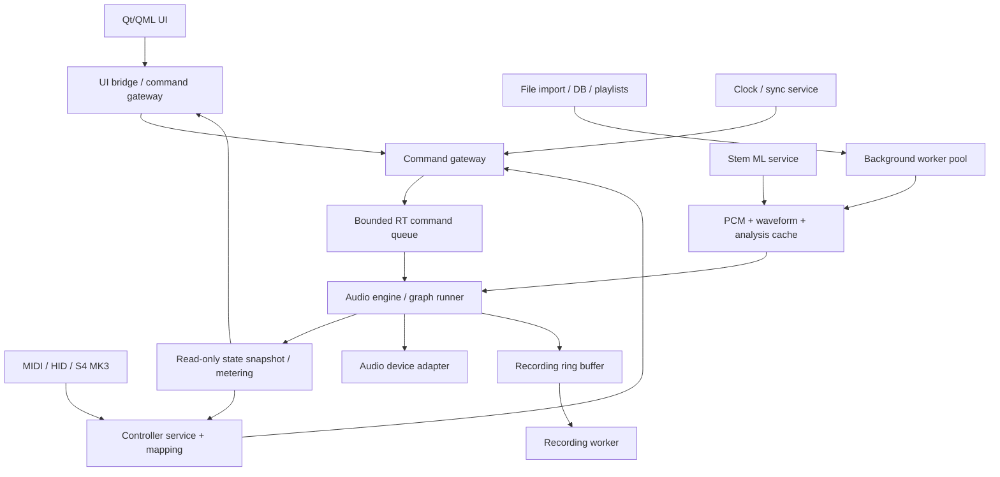

# Техническое задание: независимая DJ-платформа уровня Traktor Pro 4

**Идентификатор:** DJP-SRS-001  
**Версия:** 0.1 (проект для инженерного согласования)  
**Дата:** 2026-11-04  
**Язык:** русский  
**Статус:** концепция согласована; настоящая спецификация — первоначальная редакция, требующая формальной приёмки  
**Рабочее имя:** *DJ Platform* (не является окончательным названием продукта)

> **Назначение.** Создать самостоятельное профессиональное DJ-приложение с максимальным практическим функциональным паритетом Traktor Pro 4, с собственной архитектурой и исходным кодом, с приоритетом Linux/NixOS и аппаратной поддержки Native Instruments Traktor Kontrol S4 MK3. Задача — сопоставимость пользовательских сценариев и поведения, а не копирование исходников, фирменных ресурсов, названий и закрытых алгоритмов.

## 0. Статус требований и правила чтения

- **MUST** — обязательное требование выбранного релизного этапа; **SHOULD** — существенное улучшение; **MAY** — факультативно.
- Приоритет: **P0** = фундамент и минимальный рабочий DJ-сценарий; **P1** = полноценная рабочая станция; **P2** = расширенные возможности, необходимые для целевого паритета; **P3** = интеграции с внешними коммерческими сервисами и платформенно-зависимые функции.
- Обозначение **[R0]** — первая проверяемая вертикаль; **[R1]** — DJ-версия для реального выступления; **[R2]** — расширенная функциональность; **[R3]** — этап целевого паритета. Приоритет и релиз — разные оси.
- **AC** = acceptance criteria, критерии приёмки. Требование без теста и записи в матрице покрытия считается *неподтверждённым*.
- Все числовые пороги ниже — **проектные цели**, не измеренные характеристики готового ПО. Перед фиксацией релиза они проверяются на описанном эталонном стенде.
- При расхождениях между маркетинговой страницей и руководством Traktor Pro 4 источник для сравнения и конкретный сценарий фиксируются в `docs/parity/`. Версия и дата источника обязательны.

## 1. Цель, границы и определение успеха

### 1.1. Продуктовые цели

**DJP-GOAL-001 (MUST).** Четыре одновременно доступные независимые логические деки A–D; назначаемые режимы Track, Stem, Remix, Live Input; Preview Deck как отдельный служебный плеер.  
**DJP-GOAL-002 (MUST).** Совместимый по смыслу DJ-workflow: импорт → анализ → подготовка Cue/Beatgrid → предпрослушивание → загрузка → сведение → эффекты → запись.  
**DJP-GOAL-003 (MUST).** Надёжное воспроизведение с малой задержкой, без прерываний из-за UI, диска, сети, GPU/ML или библиотеки.  
**DJP-GOAL-004 (MUST).** Полноценное управление мышью/клавиатурой, MIDI и контроллером S4 MK3; приоритетное управление с аппаратных органов во время выступления.  
**DJP-GOAL-005 (MUST).** Переносимость аудиодвижка и доменной логики, независимость от Qt и ОС.  
**DJP-GOAL-006 (MUST).** Документированная, автоматизированно проверяемая архитектура, пригодная для параллельной работы AI-агентов.

### 1.2. Что означает «функциональный паритет»

Паритет оценивается по **матрице сценариев**, а не по сходству скриншота или совпадению звучания фирменных эффектов «бит в бит»:

- **Behavioral parity:** действие пользователя имеет сопоставимую семантику и результат.
- **Workflow parity:** типовые последовательности действий доступны без обходных процедур.
- **Capability parity:** классы возможностей покрыты, даже если реализация алгоритма собственная.
- **Hardware parity:** S4 MK3 предоставляет нужные физические органы управления, подсветку, дисплеи и аудиомаршруты в объёме технически подтверждённой поддержки.
- **Visual familiarity:** сопоставимое информационное расположение с собственными графическими активами, иконками и темой; буквальная pixel-perfect копия не требуется и не является критерием.
- **Legal exclusions:** фирменные образцы звука, защищённые алгоритмы, товарные знаки и сервисы, требующие разрешения, не копируются.

Для каждой функции в `docs/parity/matrix.csv` указываются: `feature_id`, `reference_version`, `reference_url`, `scenario`, `priority`, `release`, `implementation_state`, `test_id`, `deviation`, `license_dependency`.

### 1.3. Не входит в обязательства начального этапа

- запуск на Windows/macOS в R0; архитектура для этих платформ обязательна;
- сохранение совместимости с бинарными проектами или закрытыми данными Traktor без документированного права и разрешённых спецификаций;
- «тот же звук» iZotope Ozone, RX либо идентичные заводские паттерны/сэмплы;
- Beatport/Beatsource-подписки, требующие соглашений с провайдером;
- DVS на чужом проприетарном таймкоде без проверки прав и технической возможности;
- замена прошивки контроллера и потенциально опасное изменение аппаратного поведения.

## 2. Целевые пользователи, среды, ограничения

**DJP-ENV-001 [R0, P0].** Linux x86_64; первичная среда сборки NixOS; Wayland и X11 проверяются отдельно.  
**DJP-ENV-002 [R0, P0].** Сценарии 44,1 и 48 кГц, stereo/многоканальный ввод-вывод; внутреннее представление `f32`, расширяемое для иных форматов и частот.  
**DJP-ENV-003 [R0, P0].** Сборка через `flake.nix`/Cargo/CMake; версия Rust, Qt и зависимости закреплены в lock-файлах.  
**DJP-ENV-004 [R1, P1].** Работа полностью offline со всеми локальными треками, параметрами и проектами; сеть не нужна для базового DJ-набора.  
**DJP-ENV-005 [R1, P1].** Интерфейс рассчитан на экран 1920×1080, HiDPI и многоэкранный рабочий стол, с минимальной поддерживаемой раскладкой 1366×768; размеры минимального окна подтверждаются UX-тестом.  
**DJP-ENV-006 [R1, P1].** Настройки устройств, маршрутов, hotcue, анализов, коллекций, паттернов и пользовательских маппингов сохраняются между запусками.  
**DJP-ENV-007 [R2, P2].** 88,2/96 кГц при поддержке устройства; внутренняя маршрутизация и DSP не должны быть завязаны на фиксированные 48 кГц.

## 3. Выбранный стек и лицензионные ворота

| Слой | Выбранное решение | Требование |
|---|---|---|
| Ядро / DSP / состояние | Rust stable, Cargo workspace | Собственная кодовая база |
| GUI | Qt 6 + QML + Qt Quick Scene Graph | Отдельный процесс/модуль UI, без DSP в QML |
| Мост | Узкий C ABI или CXX/Qt C++ adapter | Только DTO/команды, отсутствие доменной логики |
| Аудиобэкенд | Адаптер CPAL либо прямой PipeWire/JACK backend | Решение после измерений и проверки многоканальной маршрутизации |
| Декодеры | Symphonia, дополнительные лицензируемые кодеки по необходимости | Фоновое декодирование, не в RT |
| Метаданные / коллекция | SQLite (WAL), миграции, FTS | Детерминированные миграции |
| Асинхронные фоновые задачи | Tokio/worker-pool вне RT | GPU/диск/сеть никогда не блокируют аудио |
| Анализ | Отдельные CPU workers | BPM/grid/key/loudness/waveform |
| ML Stems | Изолированный inference worker, ONNX/CPU/GPU | Отдельный процесс, кэш, отмена, прогресс |
| Контроллеры | Система адаптеров MIDI/HID + профиль S4 MK3 | Асинхронный I/O и безопасный тестовый режим |
| Тесты | `cargo test`, property/fuzz, offline render, GUI/hardware rigs | Gate перед слиянием |

**DJP-LIC-001 (MUST).** Перед включением стороннего компонента создать запись в `THIRD_PARTY.md`: лицензия, версия, способ линковки/взаимодействия, дополнительные обязанности, возможная патентная зависимость.  
**DJP-LIC-002 (MUST).** Лицензию самого проекта определить **до** интеграции GPL-only/GPL-compatible библиотек, если эта интеграция способна ограничить распространение. На начальном этапе статус `LICENSE: TBD`, сборка без GPL-зависимостей допустима только с надлежащим учётом; код не распространять как open source без явной лицензии.  
**DJP-LIC-003 (MUST).** Библиотека **Encdr** полезна как публичный референс/кандидат для HID S4 MK3, но распространяется на условиях GPL-3.0-or-later. Не включать её автоматически в закрытую/неопределённо лицензированную сборку.  
**DJP-LIC-004 (MUST).** **Ableton Link** также требует соблюдения GPLv2+ либо получения другой лицензии.  
**DJP-LIC-005 (MUST).** Проверить требования лицензирования используемых модулей Qt; не считать весь Qt автоматически доступным на LGPL.  
**DJP-LIC-006 (MUST).** Никакие фирменные иконки, графика, сэмплы, прошивки или proprietary binaries Native Instruments не включаются в исходный репозиторий или поставку.

**Лицензионный выбор — открытое решение ADR-001.** Рекомендовано обсудить GPL-3.0-or-later для свободного продукта, учитывая Encdr, но в этом ТЗ лицензия проекта намеренно не назначается за владельца.

## 4. Архитектура системы

### 4.1. Диаграмма компонентов



### 4.2. Потоки, процессы и границы

1. **Audio RT thread.** Выполняет граф на фиксированных блоках; гарантирует отсутствие блокировок/аллокаций/дискового и сетевого I/O/логирования/Qt-вызовов; обслуживает только заранее выделенные ресурсы.
2. **Audio I/O backend.** Адаптер к системному драйверу; при необходимости тот же RT thread с callback. Уточнить требования backend к обработке каналов и размеру callback.
3. **UI thread.** QML, сцена, рендеринг, формы; не участвует в критическом пути воспроизведения.
4. **Controller I/O.** MIDI/HID/USB, отложенная отправка LED/экранных кадров; не захватывает RT-мьютексы.
5. **Media workers.** Чтение/демультиплексирование/декодирование, подкачка PCM, FFT, beat/key analysis, метаданные; ограниченная память.
6. **Stem worker process.** Модели и GPU/CPU; разрешены сбои и рестарт без влияния на главный микс.
7. **Storage/recording workers.** SQLite, запись WAV/FLAC, атомарная фиксация настроек и восстановление сессии.

### 4.3. Командная модель

**DJP-ARCH-001 [R0, P0].** Единственный путь изменения состояния живого аудиодвижка — типизированные команды и заранее согласованные RT-параметры; UI и контроллеры не меняют DSP-структуры напрямую.  
**DJP-ARCH-002 [R0, P0].** Все действия имеют `command_id`, `target`, `origin`, `issued_at`, при необходимости `effective_sample`; команда возвращает `accepted/rejected` или регистрируемый `applied_at_sample`. Критические команды (например Stop) резервируются отдельно от частого потока регуляторов.  
**DJP-ARCH-003 [R0, P0].** Для движения ручек применяется coalescing параметров; переполнение очередей не должно приводить к скрытой потере Play/Stop/Load/Unplug.  
**DJP-ARCH-004 [R0, P0].** Снимки состояния для UI публикуются без блокирования аудио, с последовательными `revision`, `audio_clock_samples`, `epoch`. UI не трактует устаревший snapshot как подтверждение выполнения команды.  
**DJP-ARCH-005 [R0, P0].** RT-граф и буферы инициализируются вне критического потока; замены графа выполняются транзакционно на границе аудиоблока либо в заранее выделенной структуре.

Пример **семантики**, а не окончательного ABI:

```rust
pub enum DeckId { A, B, C, D }

pub enum DjCommand {
    Play { deck: DeckId, enabled: bool },
    Cue { deck: DeckId, action: CueAction },
    SeekFrames { deck: DeckId, source_frame: u64 },
    SetTempoRatio { deck: DeckId, ratio: f64 },
    SetChannelGain { deck: DeckId, linear_gain: f32 },
    SetCrossfader { position: f32 },
    SetLoop { deck: DeckId, region: Option<FrameRange> },
}

pub struct ScheduledCommand {
    pub id: u64,
    pub effective_sample: u64,
    pub command: DjCommand,
}
```

**Уточнение:** номер `source_frame` и sample clock устройства относятся к разным временным шкалам. Для импорта, seek, beatgrid и синхронизации обязателен явный `timebase`/`sample_rate`, а не неявное смешение координат.

### 4.4. Граф обработки сигнала

**DJP-ARCH-006 [R0, P0].** Граф обрабатывает блоки детерминированно: source/decoder buffer → resampler → time-stretch/key-lock → deck gain → (deck FX) → EQ/filter → channel gain/fader/crossfader → master processing/limiter → routed outputs. Конкретный pre/post-fader и send-routing задаётся конфигурацией, а не жёстко «зашит» в одну линию.  
**DJP-ARCH-007 [R1, P1].** Предусмотрены изолированные шины `master`, `booth`, `headphone/cue`, `external channels`, `recording`, `aux`.  
**DJP-ARCH-008 [R1, P1].** Граф должен поддерживать многоканальную маршрутизацию, моно/стерео, компенсацию задержек узлов и согласование фаз между частями Stem.  
**DJP-ARCH-009 [R1, P1].** Каждый DSP-узел реализует контракт `prepare(sample_rate, block_limits)`, `process(block, parameters)`, `reset`, `latency_frames`, `tail_frames` (или эквивалент). Невозможность RT-safe работы исключает узел из живого графа.  
**DJP-ARCH-010 [R1, P1].** Неизвестные/невалидные DSP-параметры отбрасываются или ограничиваются диапазоном вне RT; отключение неисправного эффекта не должно приводить к разрыву главного микса.

## 5. Функциональные требования

### 5.1. Media I/O, библиотека, аналитика

| ID | Приоритет / релиз | Требование / демонстрация |
|---|---|---|
| DJP-MEDIA-001 | P0 / R0 | Импорт локальных WAV, FLAC, MP3, Ogg Vorbis; сохранение путей и метаданных; non-DRM AAC/M4A в R1 после проверки декодера |
| DJP-MEDIA-002 | P0 / R0 | Фоновое декодирование и buffering с prefetch; seek, load/unload, ручной выбор аудиофайла |
| DJP-MEDIA-003 | P0 / R0 | Waveform overview + zoom waveform, генерация на фоне, инвалидация кэша при изменении файла |
| DJP-MEDIA-004 | P1 / R1 | Коллекция SQLite, папки, фильтр, сортировка, поиск, история, плейлисты и smart playlists |
| DJP-MEDIA-005 | P1 / R1 | ID3/Vorbis/MP4 metadata: artist/title/album/genre/year/BPM/key/cover; пользовательские заметки и рейтинг |
| DJP-MEDIA-006 | P1 / R1 | Автоанализ BPM, музыкальной тональности, loudness, peak, beatgrid и waveform; ручные исправления и analysis-lock |
| DJP-MEDIA-007 | P1 / R1 | Безопасный импорт коллекции до 100 000 треков; batch jobs с очередью, прогрессом, pause/cancel |
| DJP-MEDIA-008 | P1 / R1 | Preview Deck, прослушивание в Cue-шине, drag-and-drop в любую деку |
| DJP-MEDIA-009 | P2 / R2 | Пакетный импорт/экспорт Cue/Grid/плейлистов в собственный открытый формат; CSV/M3U/PLS где возможно |
| DJP-MEDIA-010 | P2 / R3 | Импорт пользовательских файлов Traktor через отдельно проверенный адаптер, только без обхода защиты и при наличии документированных образцов |
| DJP-MEDIA-011 | P3 / R3 | Beatport/Beatsource Streaming через официальные API и договоры с провайдерами, если они доступны независимому клиенту; иначе документированный `blocked-external` |

**AC-MEDIA:** импорт 1000 треков не блокирует UI или звук; повторный scan идемпотентен; потеря файла отображается, а не ломает всю коллекцию; обработка повреждённого медиа не приводит к crash; поиск по 100 000 записей p95 < 200 мс на зафиксированном тестовом ПК (после прогрева БД).

### 5.2. Track Deck, transport, tempo, cue и loop

| ID | Приоритет / релиз | Требование |
|---|---|---|
| DJP-DECK-001 | P0 / R0 | Одновременное воспроизведение Track Deck A/B; расширение до A–D без смены API |
| DJP-DECK-002 | P0 / R0 | Play, Pause, Stop, Cue, seek/scrub, pitch/tempo slider, gain, waveform + elapsed/remaining |
| DJP-DECK-003 | P0 / R0 | 8 Hotcue на трек; установка, удаление, активация, цвета/имена и хранение позиции |
| DJP-DECK-004 | P0 / R0 | Loop In/Out, loop sizes, activate/deactivate, manual loop, перемещение активной петли |
| DJP-DECK-005 | P1 / R1 | Quantize и Snap с настраиваемыми правилами для Cue/Loop/Jump |
| DJP-DECK-006 | P1 / R1 | Beatjump (включая дробные и кратные размеры), nudging, soft takeover параметров |
| DJP-DECK-007 | P1 / R1 | Slip/Flux и Reverse со специфицированной моделью виртуальной позиции |
| DJP-DECK-008 | P1 / R1 | Pitch range и fine adjustments; изменение темпа без изменения тональности (Key Lock) |
| DJP-DECK-009 | P1 / R1 | Воспроизведение 4 дек параллельно с независимой маршрутизацией |
| DJP-DECK-010 | P2 / R2 | Hot loops, cue types, cue mapping, move loop start/end, keep-playback-position modes |
| DJP-DECK-011 | P2 / R2 | Многоцветные/параллельные waveform views, нескольких вариантов раскладки |

**AC-DECK:** Cue/Loop/Seek в допустимой области источника не вызывают зацикливания или паники; границы EOF и коротких файлов тестируются; при обычной работе изменение параметров не создаёт слышимых щелчков; callback не читает файл и не ждёт декодер; восстановленные позиции Cue совпадают с сохранёнными в пределах 1 исходного frame.

### 5.3. Sync, Beatgrid, clock

| ID | Приоритет / релиз | Требование |
|---|---|---|
| DJP-SYNC-001 | P1 / R1 | Основной внутренний master clock и выбор deck master / auto master |
| DJP-SYNC-002 | P1 / R1 | Tempo Sync, Beat Sync, phase meter; предсказуемое поведение при tempo change |
| DJP-SYNC-003 | P1 / R1 | Хранение и редактирование статического BPM/grid, half/double BPM, tap tempo |
| DJP-SYNC-004 | P2 / R2 | Flexible Beatgrids как непрерывная монотонная функция `beat_position = f(source_time)` с кусочно-плавной темпо-картой и маркерами |
| DJP-SYNC-005 | P2 / R2 | Изменение tempo-grid на разных участках трека; sync/loop/beatjump корректны при переходах через границы участков |
| DJP-SYNC-006 | P2 / R2 | MIDI Clock send/receive и безопасное отображение внешнего tempo lock |
| DJP-SYNC-007 | P2 / R3 | Ableton Link через отдельный опциональный адаптер с соблюдением лицензии |
| DJP-SYNC-008 | P2 / R3 | Sync Pattern Player, Remix и Stem Deck от единой master beat timeline |

**AC-SYNC:** в тесте двух файлов с известными маркерами после 10 мин исполнения фазовый дрейф без внешних perturbations ≤ 2 мс; для переменного BPM использовать контрольный fixture с явной tempo-map и проверять границы всех зон; при исчезновении внешних часов — предсказуемое fallback-поведение, не скачок скорости.

### 5.4. Mixer, маршрутизация, запись

| ID | Приоритет / релиз | Требование |
|---|---|---|
| DJP-MIX-001 | P0 / R0 | Каналы A/B, master, gain/fader/crossfader; индикаторы RMS/peak/clip |
| DJP-MIX-002 | P1 / R1 | Каналы C/D, 3- и 4-полосные EQ как конфигурируемые варианты; несколько моделей фильтра |
| DJP-MIX-003 | P1 / R1 | Cue/PFL, cue-mix/cue-volume, независимые шины master/headphones/booth |
| DJP-MIX-004 | P1 / R1 | Crossfader curve presets и назначение каналов A/B/off; при расширении C/D тоже |
| DJP-MIX-005 | P1 / R1 | Audio Recorder с метками времени, выбором источника и non-RT writer; WAV как гарантированный формат |
| DJP-MIX-006 | P1 / R1 | Динамический limiter на master с защитой от переполнения и настраиваемым bypass |
| DJP-MIX-007 | P2 / R2 | Loop Recorder c overdub, undo/redo и экспортом в Remix sample |
| DJP-MIX-008 | P2 / R2 | External Mixer Mode, Live Inputs, mic/aux и маршруты через S4 и другие звуковые карты |
| DJP-MIX-009 | P2 / R3 | Несколько моделей EQ/filter с параметрической совместимостью по диапазонам управления |
| DJP-MIX-010 | P2 / R3 | Собственный максимайзер как функциональная альтернатива Ozone Maximizer; без копирования технологии/названия алгоритма |
| DJP-MIX-011 | P2 / R3 | Возможность раздельной записи master/дек/каналов при достаточной скорости диска |
| DJP-MIX-012 | P2 / R3 | Опциональный broadcast на совместимый сервер через отдельный network worker с ограниченным кольцевым буфером; обрыв сети не влияет на RT |

**AC-MIX:** проверка маршрутов методом test-tone; никакой Cue не попадает в master при отключенном routing; запись не прерывает звук и завершается читаемым файлом даже при штатном shutdown; при переполнении output лимитер не генерирует NaN/Inf.

### 5.5. FX-система

**DJP-FX-001 [R1, P1].** Формализованный API эффекта, порядок цепочки, байпас, dry/wet, sample-accurate automation там, где это нужно.  
**DJP-FX-002 [R1, P1].** 4 логических FX Units; режимы Single (1 эффект с полным управлением), Group (до 3 эффектов), Pattern Player (R2).  
**DJP-FX-003 [R1, P1].** Назначение FX Units на деку/несколько каналов; insert / post-fader / send; поддержка сохранения snapshot/preset.  
**DJP-FX-004 [R1, P1].** Начальный набор: filter, delay, echo, reverb, flanger, phaser, beat repeat, gater, simple distortion, EQ; каждый с параметрами, latency report, RT tests.  
**DJP-FX-005 [R3, P2].** Покрытие по классу **43 эффекта** из зафиксированной версии официальной матрицы Traktor Pro 4; для каждого — `parity`-карточка с собственным аналогом, параметрами, поведением и доказательством тестами.  
**DJP-FX-006 [R3, P2].** Покрытие **9 Mixer FX** функциональными аналогами; меню и маршрутизация доступны в канальной секции.  
**DJP-FX-007 [R2, P2].** BPM-synced FX and modulation; безопасное изменение параметров во время воспроизведения с smoothing и контролем хвостов.  
**DJP-FX-008 [R3, P2].** Проверка отсутствия цифрового клиппинга в ненормальных режимах, метрик хвостов эффектов, CPU budget и защиты от denormals.

**AC-FX:** каждый эффект имеет импульсный/частотный/ритмический fixture (в зависимости от класса), автоматический offline render, baseline quality check, нагрузочный тест на четырёх деках; замена/включение эффекта не вызывает неуправляемого всплеска.

### 5.6. Stem Deck и AI-разделение

| ID | Приоритет / релиз | Требование |
|---|---|---|
| DJP-STEM-001 | P2 / R2 | 4 согласованных слоя: Drums, Bass, Vocals, Other; импорт готовых stem-данных с документированным форматом |
| DJP-STEM-002 | P2 / R2 | Независимые volume, mute, filter, FX send для четырёх stem-слоёв |
| DJP-STEM-003 | P2 / R2 | Multi-track waveform, синхронизация и общая позиция всех слоёв |
| DJP-STEM-004 | P2 / R2 | Асинхронная ML-разделялка с прогрессом, отменой, обработкой ошибок, CPU fallback |
| DJP-STEM-005 | P2 / R2 | Версионирование ML-модели, хеш исходника, кэш результатов и повторное использование без повторного inference |
| DJP-STEM-006 | P2 / R2 | Воспроизводимые настройки качества/скорости и ограничение VRAM/RAM; запрещено блокировать RT при запуске модели |
| DJP-STEM-007 | P2 / R3 | Качество разделения оценивается на согласованном открытом датасете с метриками SDR/SI-SDR (где применимо) и прослушиванием; цель — конкурентоспособность, а не битовая идентичность RX |

**AC-STEM:** сумма стемов и временная привязка не содержат непредусмотренных смещений/дрейфа; трек продолжает звучать, пока ML занят; отмена не оставляет сломанного кэша; GPU OOM не завершает основной процесс DJ-приложения.

### 5.7. Remix Decks, сэмплеры, Pattern Player

**DJP-REMIX-001 [R2, P2].** Режим Remix Deck с 4 слотами; для каждого слота — банк sample cells (целевая матрица/точный объём уточняется по официальной версии).  
**DJP-REMIX-002 [R2, P2].** One-shot/Loop, latch/gate, trigger quantization, individual gain/filter/pitch/sync; load/unload/switch cell.  
**DJP-REMIX-003 [R2, P2].** Сохранение, загрузка, редактирование Remix Set в **собственном открытом формате** с явными ссылками на media assets.  
**DJP-REMIX-004 [R2, P2].** Pattern Player как отдельный музыкальный sequencer/FX Unit mode: выбор набора, шаги и шаблоны, step editing, transport, sync, pitch, decay, ducking.  
**DJP-REMIX-005 [R3, P2].** Целевое покрытие 4 Pattern Player units и 17 *категорий/эквивалентных комплектов* с оригинальными звуками (число является ориентиром официальной матрицы, не требованием копировать фабричные наборы).  
**DJP-REMIX-006 [R3, P2].** Loop Recorder → Remix sample, управление через контроллер, воспроизводимость сессии.

**AC-REMIX:** запуск/замена сэмплов не превышает заданную музыкальную сетку; сохранённый set загружается без потери темпа/назначений; отсутствуют чужие защищённые фабричные звуки в дистрибутиве.

### 5.8. Аппаратный контроллер, MIDI/HID, DVS

| ID | Приоритет / релиз | Требование |
|---|---|---|
| DJP-CTRL-001 | P0 / R0 | Абстракция физического устройства, discovery, соединение, capabilities, события и выходные команды |
| DJP-CTRL-002 | P0 / R0 | MIDI input/learn/mapping/keyboard mapping с отдельными профилями и конфликтами назначений |
| DJP-CTRL-003 | P1 / R1 | Профиль S4 MK3: transport, mixer, hotcues, loop controls, browser navigation, routing, LEDs |
| DJP-CTRL-004 | P1 / R1 | Обнаружение S4 MK3 без прав root через documentable udev permissions; hotplug/reconnect |
| DJP-CTRL-005 | P1 / R1 | Отображение состояния деки, треков и cue на двух аппаратных дисплеях — после proof-of-concept аппаратного протокола |
| DJP-CTRL-006 | P2 / R2 | Jogwheel reading/touch и безопасная управляемая моторизация/feedback только после аппаратного safety gate |
| DJP-CTRL-007 | P2 / R2 | LEDs, RGB pads, channel meters, экранная частота обновления и пользовательские раскладки |
| DJP-CTRL-008 | P2 / R3 | Общий профиль HID для других устройств NI и community mappings иных производителей |
| DJP-CTRL-009 | P2 / R3 | DVS subsystem: timecode acquisition/decoder, calibration, absolute/relative modes, cue/sync и устойчивость к dropout — на законно используемых форматах/носителях |
| DJP-CTRL-010 | P3 / R3 | CDJ HID и специфические vendor protocols как отдельные лицензируемые/проверяемые адаптеры |

**Аппаратный safety gate S4:**

1. Сначала read-only режим: обнаружение VID/PID, HID reports, карта органов управления; не отправлять неизвестные payload.
2. Далее отдельный тест LED и безопасного экрана с rate-limit; проверить что интерфейс реально доступен Linux-драйверу.
3. Только затем моторизованные колёса: ограничение torque/velocity/времени, аварийный stop и физическое подтверждение безопасных режимов. Не запускать мотор автоматически при подключении.
4. Audio interface контроллера тестируется **отдельно** от HID: Encdr не обеспечивает audio streaming.
5. Для каждого устройства — `hardware-profile.md`, табличная раскладка репортов, evidence/scope, устройство/прошивка/OS, regression checklist.

**AC-CTRL:** выпадение USB не вызывает crash или звуковой разрыв на другом audio device; событие кнопки соответствует маппингу; состояние индикаторов в пределах выбранной частоты обновления; firmware не изменяется.

### 5.9. GUI/UX

**DJP-UI-001 [R0, P0].** Основные области: глобальная панель, деки, микшер, FX, browser/list, waveform, статус audio device.  
**DJP-UI-002 [R0, P0].** Рабочая раскладка 2-deck, тёмная цветовая схема, динамические индикаторы play/cue/loop/level.  
**DJP-UI-003 [R1, P1].** 4-deck layout, переключаемые compact/full/advanced панели, сохранение layouts.  
**DJP-UI-004 [R1, P1].** Плавные waveform + zoom, animated playhead, beat markers, hotcue markers, stem lanes; доступность информации при 1080p.  
**DJP-UI-005 [R1, P1].** Keyboard shortcuts / focus navigation / понятная индикация ошибки и отсутствие UI freeze во время анализа/сканирования.  
**DJP-UI-006 [R2, P2].** Настраиваемая тема/цветовые режимы waveform; multi-monitor workflow.  
**DJP-UI-007 [R2, P2].** Профессиональный экран управления эффектами, стемами, паттернами, DVS, устройствами и маршрутизацией.  
**DJP-UI-008 [R3, P2].** Матрица визуального и workflow-паритета по сериям эталонных сценариев; сравнивается расположение функций, читаемость и время операции, не copyrighted artwork.

**AC-UI:** при тестовой нагрузке (сканирование библиотеки + запись + воспроизведение) поток Qt не препятствует аудио; тестовая сессия пользователя с внешним контроллером показывает основные действия без мыши; layout/zoom сохраняются при перезапуске.

### 5.10. Настройки, пользовательские сессии, системные сценарии

**DJP-SET-001 [R1, P1].** Настройки аудиобэкенда, устройств/частоты/буфера, routing, crossfader/EQ, hotkeys, контроллеров, анализа, кэша, бэкапов.  
**DJP-SET-002 [R1, P1].** Сериализация полного рабочего состояния с явной схемой и versioned migrations (без сохранения сторонних аудиофайлов в проект по умолчанию).  
**DJP-SET-003 [R1, P1].** Автосохранение без блокирования аудио и откат некорректной миграции; journal/recovery после crash.  
**DJP-SET-004 [R2, P2].** Export/import пользовательских preset + controller mapping как читаемых файлов YAML/JSON/TOML; безопасный парсер и schema validation.  
**DJP-SET-005 [R3, P2].** Профили клубных setups: internal/external mixing, DVS, streaming, S4 MK3, двух/четырёхдековая раскладка.

## 6. Контракты доменной модели и хранилища

### 6.1. Обязательные сущности

- `Track` (`track_id`, `content_fingerprint`, paths, tags, duration, sample_rate, audio channels, art, analysis version).
- `Analysis` (`bpm_estimate`, `tempo_map`, `musical_key`, `loudness`, `waveform_cache_ref`, version, confidence, source).
- `CuePoint` (`track_id`, `source_frame`, type, hotcue_slot, color, name).
- `Loop` (`source_start_frame`, `source_end_frame`, active, quantization policy).
- `DeckState` (`deck_id`, flavor, transport, media_ref, source_position, tempo_ratio, key_shift, cue/loop state, routing, revision).
- `StemAsset` (`source_track`, model/version, component, alignment offset, format/cache ref, checksum).
- `RemixSet`, `SampleCell`, `PatternKit`, `PatternStep`, `FxPreset`, `ControllerProfile`, `Session`, `AudioRoute`.

**DJP-DATA-001.** DB schema и API схемы не раскрывают внутренние pointer-адреса, Qt-классы и backend-специфические типы.  
**DJP-DATA-002.** Временные метки с аудиоточностью выражаются в frames+rate или рациональных временны́х единицах, не float milliseconds; внутри beatgrid существуют отдельные `beat_position` и `source_time`.  
**DJP-DATA-003.** Любой кэш имеет явную версию алгоритма и input fingerprint; сбой/старение кэша приводит к пересозданию, а не потере исходных пользовательских данных.  
**DJP-DATA-004.** Ссылки на файлы устойчивы к переносам при наличии ручного relink; fingerprint используется для обнаружения переименований, но не отменяет требования выбора корректного файла пользователем.  
**DJP-DATA-005.** БД работает в WAL с сериализованным writer вне аудиопотока; миграции обратимы через backup и тестируются на предыдущих схемах.

### 6.2. Внутренние протоколы

- **Command Protocol v1:** типизированная команда, ID, source, session epoch, priority, optional effective sample, ack.
- **State Snapshot v1:** revision, sample clock, deck/mixer/FX/meters, error flags, device info; частота для UI конфигурируется (типично 30–60 Hz).
- **Background Job Protocol v1:** job type, content fingerprint, version, priority, progress, cancel, output artifact; не пропускается непосредственно в RT.
- **Controller Profile Schema v1:** capabilities, inputs, outputs, bindings, LED/screen templates, safety constraints.
- **Session Format v1:** JSON manifest с версией и ссылками на audio assets; SQLite остаётся источником коллекции.

Все протоколы имеют schema version, тесты backward/forward compatibility и безошибочное сообщение при несовместимой версии.

## 7. Нефункциональные требования, измерения и пороги

### 7.1. Аудио real-time

| ID | Целевой критерий | Проверка |
|---|---|---|
| DJP-NFR-001 | Никаких heap allocations, mutex/wait, file/network I/O, Qt, ML и synchronous logging в audio callback | Аудит, instrumentation, стресс-тесты |
| DJP-NFR-002 | Стабильная работа 48 кГц / 256 frames (~5,33 мс период) с 2/4 деками | Двухчасовой soak и диагностический счётчик xrun |
| DJP-NFR-003 | В типовой 4-deck нагрузке p99 времени обработки блока < 60% периода, максимальные значения < 85% в контрольном прогоне | RT telemetry, сохранённый отчёт |
| DJP-NFR-004 | Нулевые xrun приложения за 2 ч при фиксированном эталонном оборудовании и согласованной нагрузке | Soak test; системные xruns отдельно |
| DJP-NFR-005 | 128 frames (48 кГц, ~2,67 мс) — целевой low-latency профиль R2, не обещание для всех хостов | Отдельная аппаратная матрица |
| DJP-NFR-006 | Физическая round-trip latency измеряется через loopback; цель < 20 мс на квалифицированном профиле, при невозможности — честное отображение результата | Измерительная конфигурация + отчёт |
| DJP-NFR-007 | Изменение файлового состояния, уничтожение UI или падение ML worker не останавливает уже буферизованный звук (до исчерпания buffer) | Fault injection |
| DJP-NFR-008 | Нет NaN/Inf в выходе при допустимом вводе; уровни ограничиваются предусмотренным gain staging/лимитером | Property/fuzz/impulse tests |

**Условие приёмки:** «нулевые xruns» относится к **зафиксированному стенду** (CPU, governor, kernel, audio server, device, versions, нагрузка), а не гарантируется на произвольном Linux. Итоговый `benchmark.md` включает среднее/p99/max, количество xruns, test tracks, sample rate, buffer size, число дек, активные эффекты и сведения о нагрузке системы.

### 7.2. UX, надёжность, защита данных

**DJP-NFR-009.** Cold start до готовности UI < 5 c на фиксированном стенде без начального сканирования библиотеки.  
**DJP-NFR-010.** UI: цель 60 FPS при стандартном сценарии, допускаются временные drops при фоновых задачах, но audio deadline неприкосновенен.  
**DJP-NFR-011.** Отсутствие необратимой потери пользовательских cues/playlists при crash; atomic transactions, backup до миграции.  
**DJP-NFR-012.** Валидация метаданных, локальных путей, MIDI/HID payload, model files; запрет на небезопасную десериализацию.  
**DJP-NFR-013.** Отсутствие обязательной телеметрии и удалённых аккаунтов; диагностика экспортируется локально пользователем, персональные пути по умолчанию редактируются.  
**DJP-NFR-014.** Контроль памяти с policy: 2 GB типовой RAM целевой рабочий бюджет R1 без ML при разумном кэше; для ML собственный лимит и отчёт о VRAM.  
**DJP-NFR-015.** Критические обновления UI и controller output не создают неограниченных очередей и роста памяти.  
**DJP-NFR-016.** Запуск и экстренное прекращение звука не зависят от состояния сети, базы аналитики или графической карты после инициализации.

## 8. План тестирования и доказательная база

### 8.1. Уровни

1. **Unit tests:** timebase/beatgrid maths, sample bounds, DSP params, mixing laws, serializer, queue coalescing.
2. **Property tests:** arbitrary but valid BPM maps, source sample rates, loop/seek boundaries, repeated automation, no NaN.
3. **Fuzz tests:** malformed media/metadata, controller reports, session files, playlist imports; без реального hardware output.
4. **Offline audio golden tests:** deterministic PCM fixtures; WAV/hash + numeric tolerances для DSP версий; частотные искажения/aliasing/metering.
5. **RT integration:** loopback backend, simulated clock, command schedule, CPU measurements, xruns.
6. **UI tests:** QML component visual smoke, keyboard mapping, workflows, state snapshot consistency.
7. **Hardware-in-loop:** S4 MK3 buttons, knobs, pads, encoders, displays, audio outputs, hotplug; моторы только в безопасном тестовом режиме.
8. **Soak/failure tests:** ≥2 ч 4-deck + FX + record; unplug, lost disk, DB busy, GPU worker crash, suspend/resume.
9. **Comparison tests:** Traktor reference workflow captured from public documentation or законно доступного продукта; ожидание описывается семантически.

### 8.2. Матрица покрытия

Каждое требование `DJP-*` присутствует в `docs/requirements/traceability.csv`: `req_id, owner, priority, release, source, implementation_path, test_id, test_status, evidence_link, reviewer, date`.

**Definition of Done для любой задачи:**

- Есть реализация и публичный контракт модуля;
- есть позитивные, негативные и граничные тесты;
- есть исправления/обновление документации;
- есть отчёт о лицензиях/источниках, затронутых задачей;
- CI проходит без ослабления тестов;
- для критического DSP — offline reference + RT performance result;
- для S4 — hardware result либо явно отмеченный `hardware-not-verified`;
- ревьюер подтвердил соответствие требованиям, без самоприёмки агентом.

## 9. Этапы, зависимости и релизные ворота

Ниже **предварительные оценки трудоёмкости** (не календарные гарантии), зависящие от опыта, качества алгоритмов, лицензий и числа параллельных работников. Наличие ИИ-агентов снижает рутину, но не отменяет аппаратной проверки и работы со звуком.

| Этап | Результат | Предпосылки | Оценка усилий |
|---|---|---|---|
| **M0 — Blueprint** | Репозиторий, интерфейсы, RT-спайк, лицензии, benchmark stand | Нет | 2–4 чел.-нед. |
| **M1 — Audio vertical slice [R0]** | 2 деки, WAV/FLAC, seek/cue/loop, waveform, 2ch mixer, headless render, простая Qt-оболочка | M0 | 6–12 чел.-нед. |
| **M2 — Performing core [R1]** | 4 деки, Sync/BPM, keylock, EQ/filter/cue, библиотека, recording | M1 | 10–18 чел.-нед. |
| **M3 — Hardware / UX [R1]** | Рабочая интеграция S4 MK3, аудиомаршруты, дисплеи после PoC, layouts | M1–M2 | 8–16 чел.-нед. |
| **M4 — FX / advanced mixing [R2]** | FX graph/units, robust routing, external input, loop recorder | M2 | 8–14 чел.-нед. |
| **M5 — Stems / Remix / Pattern [R2]** | 4 stems, offline separation, Remix Sets, Pattern Player | M2–M4 | 14–28 чел.-нед. |
| **M6 — Advanced sync [R2]** | Flexible beatgrids, external clock, sync validation | M2–M5 | 8–16 чел.-нед. |
| **M7 — Parity & integrations [R3]** | Каталог FX, 9 Mixer FX, максимайзер, DVS, optional online services | M3–M6 | 16–32 чел.-нед. |
| **M8 — Product hardening [R3]** | 4-deck soak, usability, hardware matrix, docs, packaging, recovery | Все | 12–24 чел.-нед. |

**Реалистичное ожидание:** первая работающая DJ-вертикаль — задача нескольких месяцев при одном опытном инженере с ИИ-помощниками; максимальный качественный паритет — большой проект, потенциально год и более. Оценки уточняются по факту M0 и M1; никакого обещания полного паритета к фиксированной дате нет.

### 9.1. Release gates

- **Gate R0:** 2 деки играют одновременно, музыкальный файл можно выбрать, прослушать, поставить cue/loop, свести через crossfader; UI не блокирует звук; headless render воспроизводим; отсутствуют RT-нарушения.
- **Gate R1:** 4 деки, полноценный audio routing/cue, BPM/Sync, hotcue, keylock, коллекция/recording, основное управление S4 MK3; 2h live soak пройден на стенде.
- **Gate R2:** Stem/Remix/Pattern, flexible beatgrids, FX и развитое аппаратное управление; все соответствующие требования имеют тесты.
- **Gate R3:** матрица целевого паритета закрыта по согласованным сценариям; критические «сервис зависит от третьей стороны» и «юридически ограничено» имеют официально задокументированный статус `blocked/excluded`, а не фиктивное `done`.

## 10. Структура репозитория

```text
dj-platform/
├── README.md
├── LICENSE                     # создаётся после ADR-001
├── THIRD_PARTY.md
├── SECURITY.md
├── CONTRIBUTING.md
├── Cargo.toml
├── Cargo.lock
├── flake.nix
├── flake.lock
├── rust-toolchain.toml
├── CMakeLists.txt
├── .github/workflows/
├── apps/
│   ├── dj-ui/                    # Qt/C++ shell + QML
│   │   ├── src/
│   │   ├── qml/{decks,mixer,fx,browser,dialogs,widgets}/
│   │   └── tests/
│   ├── dj-headless/              # без GUI: сценарии, offline render, bench
│   └── dj-cli/                   # импорт/анализ/диагностика
├── crates/
│   ├── dj-domain/                # команды, ID, события, DTO, времени́е координаты
│   ├── dj-audio-core/            # audio graph, RT queue, block scheduler
│   ├── dj-audio-io/              # device adapter interfaces
│   ├── dj-deck/                  # track transport, cue, loop, source positions
│   ├── dj-dsp/                   # resampler, filters, EQ, dynamics
│   ├── dj-time-stretch/          # tempo/keylock
│   ├── dj-mixer/                 # buses, crossfader, gain, metering
│   ├── dj-fx/                    # effects and effect graph
│   ├── dj-sync/                  # master clock, phase, beatgrid maps
│   ├── dj-codec/                 # decoders + buffering
│   ├── dj-analysis/              # waveform, BPM, key analysis
│   ├── dj-library/               # SQLite, index, playlists, import
│   ├── dj-stems/                 # Stem Deck + asset management
│   ├── dj-remix/                 # Remix Deck, sampler
│   ├── dj-pattern/               # Pattern Player
│   ├── dj-controller-core/       # MIDI/HID abstractions, mappings
│   ├── dj-controller-s4mk3/      # separate hardware profile/adapter
│   ├── dj-recording/             # recording queue/writers
│   ├── dj-session/               # persisted sessions, settings
│   ├── dj-bridge/                # Rust side of UI bridge
│   └── dj-testkit/               # fixtures, simulated clock, instrumentation
├── services/
│   └── stem-worker/              # isolated inference process
├── schemas/
│   ├── command-v1.json
│   ├── state-v1.json
│   ├── session-v1.json
│   └── controller-profile-v1.json
├── docs/
│   ├── requirements/{traceability.csv,glossary.md}
│   ├── architecture/{overview.md,rt-contract.md,threading.md,api.md}
│   ├── adr/{0001-license.md,0002-audio-backend.md,0003-ui-bridge.md}
│   ├── parity/{matrix.csv,reference-inventory.md}
│   ├── hardware/s4mk3/{hardware-profile.md,test-matrix.md}
│   ├── qa/{test-plan.md,benchmarks.md,fixtures.md}
│   └── agents/{AGENTS.md,task-template.md}
├── assets/
│   ├── themes/                   # только собственная графика
│   └── test-audio/               # собственные/разрешённые тестовые данные
├── benchmarks/
└── scripts/
```

Разделение crates — граница ответственности, а не требование создавать по отдельному crate на любую небольшую функцию. Архитектурный gate позволяет объединять модуль при отсутствии реальной самостоятельной роли.

## 11. Протокол работы ИИ-агентов

### 11.1. Общие обязательные правила

1. Каждая задача привязана к существующим `DJP-*` и имеет входы, выходы, ограничения, тесты и признак `hardware-needed`.
2. Агент не меняет публичные интерфейсы/формат хранилища без предварительно принятого ADR и migration plan.
3. Агентам запрещено добавлять пакет, копировать код/ресурс из Traktor/NI/Mixxx или включать GPL-код без license review.
4. Агент не редактирует одновременно с другим агентом один RT-critical crate без распределения code ownership.
5. Любой DSP код обязан учитывать RT contract и потребление CPU/памяти. `unwrap`, `panic`, блокирующий лог и выделение памяти в callback — дефект.
6. Автоматическая генерация кода допускается, но описание тестовых результатов должно соответствовать **фактически выполненным** командам. Агент не имеет права маркировать hardware test как пройденный без подключённого устройства.
7. Merge требует человека-ревьюера для DSP, лицензий, файлового ввода и аппаратно опасных команд.
8. При отсутствии данных агент создаёт ADR/исследовательскую задачу со статусом `unknown`, а не придумывает спецификацию протокола.

### 11.2. Роли

- **Architect/Orchestrator:** интерфейсы, ADR, приоритеты, интеграция, cross-crate review.
- **Audio Core Agent:** RT engine, clocks, buffering, offline output.
- **DSP Agent:** EQ/time stretch/FX с акустическими тестами.
- **Media Agent:** decoder, waveform, analysis, storage.
- **UI Agent:** Qt/QML, адаптер команд, UI tests.
- **Hardware Agent:** MIDI/HID/S4, safe test harness, Linux permissions.
- **QA Agent:** fixtures, CI, stress, golden renders, traceability.
- **Compliance Agent:** лицензии и независимость реализации.

### 11.3. Шаблон постановки задачи

```yaml
id: DJP-TASK-000
name: "..."
requirements: ["DJP-ARCH-001"]
release: R0
priority: P0
owner_role: audio-core
inputs: ["docs/architecture/rt-contract.md"]
deliverables: ["crates/dj-audio-core/src/lib.rs", "...tests..."]
interfaces_to_preserve: ["Command Protocol v1"]
acceptance:
  - "cargo test ... passes"
  - "No allocations in RT process()"
  - "Offline fixture evidence attached"
blocked_by: []
hardware_needed: false
license_review_needed: false
status: proposed
```

## 12. Первые практические задачи: готовый backlog для старта

### A00 — Репозиторий и воспроизводимая среда

- **Owner:** Architect/DevOps; **depends:** none; **release:** R0.
- **Deliverables:** Rust workspace, Qt/CMake shell, `flake.nix`, `rust-toolchain.toml`, CI (`fmt`, `clippy`, unit tests), команды сборки, quickstart.
- **AC:** новый разработчик на NixOS может выполнить `nix develop`, `cargo test --workspace`, собрать и запустить пустое UI-приложение; locked dependencies.

### A01 — Архитектурный договор RT и scheduler

- **Owner:** Audio Core; **depends:** A00.
- **Deliverables:** `docs/architecture/rt-contract.md`, bounded queue, sample clock, offline graph skeleton; блоки 64/128/256/512.
- **AC:** генератор sine 440 Hz → WAV с известным числом кадров; scheduled Play/Stop происходит в указанном аудиосэмпле; RT thread не alloc/lock.

### A02 — Codec и PCM prefetch

- **Owner:** Media; **depends:** A00/A01 API.
- **Deliverables:** `dj-codec`, декодер WAV/FLAC и MP3 при прошедшем license review, seek/index, bounded PCM ring; стресс-тест медленного диска.
- **AC:** файл можно загрузить/seek; RT читает только ring; underrun явный и диагностируется; EOF не crash.

### A03 — Две деки и Cue/Loop

- **Owner:** Audio Core/Deck; **depends:** A01/A02.
- **Deliverables:** `dj-deck`, transport state machine, play/pause/cue/seek/hotcue/loop.
- **AC:** детерминированный offline render двух синхронно стартующих треков; 8 Cue persist (через mock storage); loop boundary tests.

### A04 — Микшер и многоканальная модель

- **Owner:** DSP/Audio Core; **depends:** A01/A03.
- **Deliverables:** `dj-mixer`, 2/4 channel faders, crossfader, master/cue buses, meters, routing map.
- **AC:** импульс/тестовый сигнал на 4 входах достигает только назначенных выходов; crossfader end conditions; no NaN.

### A05 — Audio I/O benchmark spike

- **Owner:** Audio/Platform; **depends:** A01.
- **Deliverables:** CPAL vs native PipeWire/JACK сравнительная заметка; перечисление устройств, форматов и channels, output loopback и xrun counter.
- **AC:** фактический тест 48 kHz / 256 frames с отчётом; записанный вердикт ADR-002; при отсутствии устройства `not tested`, а не success.

### A06 — UI skeleton и мост команд

- **Owner:** UI; **depends:** A00/A01 + draft command schema.
- **Deliverables:** Qt/QML shell, 2 decks/mixer/browser placeholders, bridge, transport buttons, live waveform placeholder bound to actual engine snapshot.
- **AC:** Play/Cue меняют engine state, не локальную картинку; UI can restart without invalidating engine; чистое разделение QML/DSP.

### A07 — Waveform analysis v1

- **Owner:** Media/DSP; **depends:** A02.
- **Deliverables:** min/max/RMS peak pyramid, cached overview, deterministic zoom sampling; waveform QML renderer.
- **AC:** длина и позиция waveform совпадает с source frames; zoom renders 60 FPS on reference rig; cache invalidation.

### A08 — SQLite collection and persistence

- **Owner:** Media/Storage; **depends:** A00.
- **Deliverables:** migrations, Track/Cue/Playlist model, CRUD/query, path relocation UI contract, crash/recovery fixtures.
- **AC:** сохранение/перезапуск Cue/Track и smart search; migration rollback backup; не зависит от RT.

### A09 — S4 MK3 read-only hardware probe

- **Owner:** Hardware; **depends:** A00, compliance review.
- **Deliverables:** CLI enumeration, read-only events for buttons, faders, encoders, jogs, VID/PID and firmware info; documented test procedure, udev rule example.
- **AC:** тестирование на физическом S4 MK3 с подписанной таблицей observed events; не посылать неизвестные команды, не запускать мотор, не модифицировать firmware.

### A10 — S4 MK3 audio-output routing probe

- **Owner:** Audio/Hardware; **depends:** A05/A09.
- **Deliverables:** карта входов/выходов OS audio для S4 MK3; test tone Main/Cue/Booth, compatibility matrix PipeWire/JACK/ALSA.
- **AC:** измеренная проверка headphones vs master, не по предположению; раздельное описание HID и аудио.

### A11 — QA и инструменты для агентов

- **Owner:** QA/Architect; **depends:** A00/A01.
- **Deliverables:** golden PCM fixtures (только разрешённые), scripted offline rendering, RT audit checklist, traceability CSV, PR template, agents instructions.
- **AC:** CI показывает mismatch golden output; регрессия RT contracts приводит к failed review; ни одна задача не закрывается без evidence.

### A12 — Лицензии и аппаратный adapter decision

- **Owner:** Compliance/Architect; **depends:** none.
- **Deliverables:** ADR-001: лицензия проекта; Encdr включать/не включать; Qt/link/symphonia summary; THIRD_PARTY.md.
- **AC:** до merge GPL dependency имеется documented approval; при отрицательном вердикте предусмотрен чистый собственный адаптер по разрешённым спецификациям.

### A13 — Первая интеграционная demo-сборка

- **Owner:** Integrator; **depends:** A01–A08, A11; A09/A10 не блокируют desktop demo.
- **Deliverables:** Linux GUI + headless runner; две деки/два файла/две waveform, mixer/crossfader, cue/loop, README со сценарием. Запись планируется в R1, не блокирует R0.
- **AC:** Gate R0; dry-run replay + фактический USB hardware report, если доступен.

### Рекомендуемая параллельность

- **Волна 1:** A00 + A12; после каркаса — A01 + A08 + A09 + A11.
- **Волна 2:** A02 + A05 + A06; после A02 — A07; затем A03 и A04.
- **Волна 3:** A10 + A13; после Gate R0 — архитектурные задачи Sync / FX / Stems.
- Интегратор единолично закрепляет версии контрактов и разрешает merge в `main`.

## 13. Контроль качества и политика изменений

- В `main` нет прямых AI commits без review; изменения через PR с ссылками на требования.
- `cargo fmt`, `cargo clippy -D warnings`, `cargo test --workspace`, QML lint/tests, dependency license scan и офлайновые аудио-тесты — обязательные CI-gates.
- Еженедельный RT benchmark на неизменном стенде; сравнение p99/peak callback duration.
- Защищённые ветки; stable dependency lock; CI SBOM для поставки.
- Любое изменение API/схемы/качества или области лицензирования сопровождается ADR или versioned migration.
- Каждому серьёзному аудиодефекту соответствует воспроизводимый WAV test case и regression test.

## 14. Риски и неопределённости

| Риск | Влияние | Минимизация |
|---|---|---|
| Time-stretch/keylock на профессиональном уровне сложнее базового resampling | Качество и latency | A/B listening, собственные аудиофикстуры, контроль латентности, отдельно лицензируемый качественный модуль |
| Flexible beatgrids для живой музыки | Ошибки sync | Формальная математическая модель и property tests tempo maps |
| Многоканальный audio backend в S4 на NixOS | Cue/Booth могут быть недоступны | Ранний A05/A10 probe и фиксированная матрица |
| Моторизованные джоги и закрытый HID | Риск оборудования | Read-only → LED/display → ограниченный motor PoC, emergency stop |
| ML Stems грузит GPU/VRAM и CPU | Xrun/crash | Изоляция процессом, memory limits, cache, только offline по умолчанию |
| Большая библиотека/плохие метаданные | UI stutter/data loss | SQLite/FTS, фоновые workers, fuzz, migrations/backup |
| Права на Encdr, Ableton Link, Qt, аудиокодеки | Публикация может быть ограничена | ADR-001/THIRD_PARTY и dependency gating |
| Фирменные FX / Ozone / RX / Pattern kits | Невозможен byte-identical parity | Функциональные аналоги и оригинальный контент |
| Коммерческие сервисы / DVS formats | Недоступны API/лицензии | Отдельные P3 adapters, documented blockers |
| Многопоточная генерация кода ИИ | Несовместимые интерфейсы, ложные «готово» | Contract-first, CI, evidence, code ownership и review |
| 43 FX и 9 Mixer FX | Разрастание объёма | Каталог и пороговый план реализации на R3, приоритет реальных DJ-сценариев |

## 15. Вопросы, требующие решения владельца продукта (не блокируют M0)

- **ADR-001:** GPL-3.0-or-later open source, permissive open source без GPL-зависимостей, либо закрытая/двойная лицензия?
- **ADR-002:** CPAL vs прямой PipeWire/JACK для основного многоканального backend?
- **ADR-003:** QML + C++/Rust bridge в одном процессе или отдельный UI-процесс (R0 может использовать один процесс с изоляцией потоков)?
- **ADR-004:** точная трактовка «максимального паритета»: стоп-лист закрытых функций и допустимые эквиваленты по sound/UX.
- **ADR-005:** коммерческие аудиосервисы — только официально лицензированные SDK/API либо вне scope.
- **ADR-006:** приоритеты Windows/macOS после R1.
- **ADR-007:** параметры и безопасность аппаратного управления S4 jog motors после PoC.

**Примечание:** некоторые решения (особенно лицензия и backend) должны быть зафиксированы до соответствующего merge. Статус `TBD` не даёт права молча выбрать несовместимую библиотеку.

## 16. Акт приёмки ТЗ и дальнейшие документы

Чтобы превратить этот проект ТЗ v0.1 в исполнимую спецификацию v1.0, необходимо:

1. Принять или скорректировать целевую архитектуру и лицензирование (ADR-001–003).
2. Утвердить эталонную версию Traktor и заполнить `docs/parity/matrix.csv` по всем экранным/звуковым функциям на основании документации и тестовых сценариев.
3. Провести M0 и определить CPU/device reference bench; заменить проектные NFR на измеренные релизные критерии.
4. Закрепить command protocol и storage schema v1 для независимой работы агентов.
5. Развернуть backlog A00–A13 и CI. Первой публичной демонстрацией считать Gate R0.

## 17. Официальные и технические источники

Материалы использованы для формирования **требований к функциональному аналогу**, не для заимствования чужого кода/дизайна. Ссылки проверены при подготовке v0.1; страницы поставщиков могут меняться.

1. Native Instruments — Traktor Pro 4, официальная сравнительная таблица функций: https://www.native-instruments.com/products/traktor-pro/
2. Native Instruments — Traktor Pro Manual, online guide: https://docs.native-instruments.com/online-guides/traktor-pro-manual/en/traktor-overview.html
3. Native Instruments — Basic Usage Tutorials: https://docs.native-instruments.com/online-guides/traktor-pro-manual/en/basic-usage-tutorials.html
4. Native Instruments — Traktor Kontrol S4 MK3 product/specifications: https://www.native-instruments.com/products/traktor-kontrol-s4
5. Native Instruments — S4 MK3 user manual: https://www.native-instruments.com/fileadmin/ni_media/downloads/manuals/traktor/TRAKTOR_KONTROL_S4_MK3_Manual_English_0719.pdf
6. Encdr — publicly documented NI USB HID control/screen library, GPL-3.0-or-later: https://github.com/RufusIbiza/Encdr
7. RustAudio CPAL — audio callbacks and backend architecture: https://docs.rs/cpal/latest/cpal/
8. Symphonia — audio decoding, MPL 2.0: https://github.com/pdeljanov/Symphonia
9. Qt 6 — open-source licensing policy: https://doc.qt.io/qt-6/licensing.html
10. Ableton Link — dual licensing, GPLv2+ / proprietary: https://github.com/Ableton/link

---

**Конец ТЗ v0.1.** Примечание для участников: этот документ — исходная спецификация и критерии для архитектурных решений, а не подтверждение, что перечисленные возможности уже реализованы. Каждая реализация должна сопровождаться доказательствами выполнения и отдельным сравнением с заданными эталонными сценариями.
